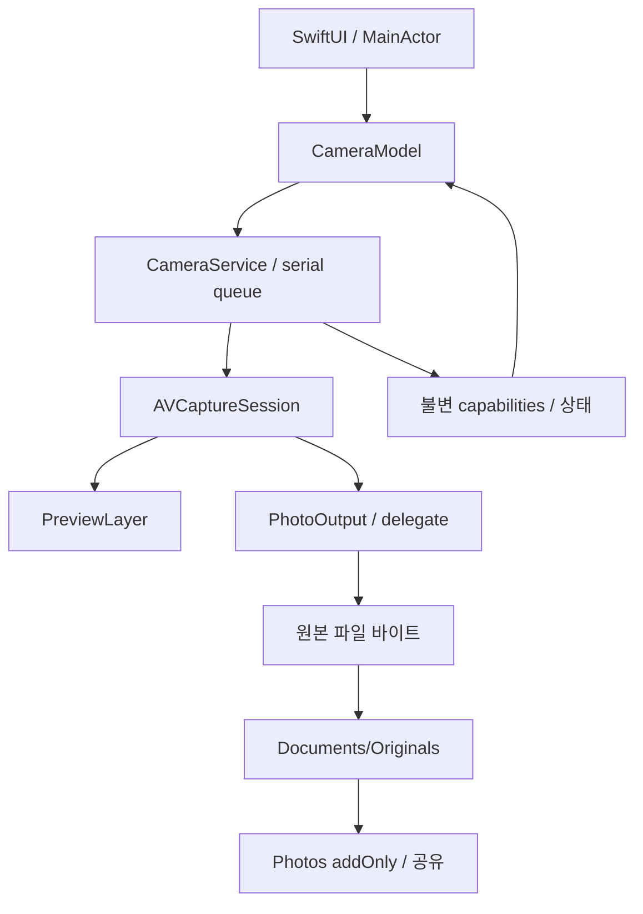
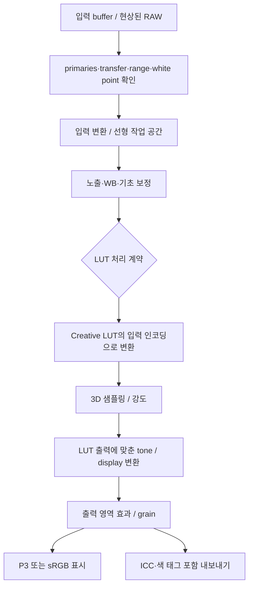

# B·E. PhotoP 기술 설계와 초기 코드 아키텍처

## 아키텍처 결정 기록

| ADR | 결정 | 대안 / 이유 / 검증 |
| --- | --- | --- |
| 001 | iOS SwiftUI + AVFoundation, Android Kotlin + Camera2 | 전체 Flutter/RN 통합은 초기 제외. 네이티브 카메라 기능을 제한하지 않음. Android는 Phase 8 |
| 002 | iOS 17을 초기 최소 버전으로 제안·설정 | 최신 AVCam 샘플은 더 높은 OS를 요구하므로 프로젝트를 복사하지 않음. 실기기 최소·최신 OS 검증 후 확정 |
| 003 | 첫 구현은 직렬 DispatchQueue가 세션 소유 | actor/custom executor도 가능하나 첫 단위에는 단순한 검증된 격리 계약 사용. MainActor는 UI만 담당 |
| 004 | Swift 5 언어 모드 + complete concurrency 진단 | Swift 6 strict 전환을 동시에 수행하지 않음. Sendable 경계와 AVFoundation 콜백 검증 후 전환 |
| 005 | 첫 코드에는 제3자 런타임 의존성 없음 | NextLevel을 전체 채택하면 추가 상태 계층 발생. MetalPetal은 Phase 2 비교 후보 |
| 006 | 프리뷰는 PreviewLayer, Phase 2 GPU 경로 도입 | LUT 구현 때 VideoDataOutput + CVMetalTextureCache + MTKView 사용. 고해상도 사진은 PhotoOutput 별도 경로 |
| 007 | JPEG 원본 바이트를 앱에 먼저 저장 | UIImage 재인코딩 금지. Photos 거부/실패 시 앱 원본 공유·저장 재시도 가능 |
| 008 | 카메라 서비스 프로토콜과 C++ 코어는 필요 시 추가 | 한 구현만 있는 지금은 concrete service. 플랫폼 계약은 문서·fixture로 정의 |
| 009 | 자산 목록과 앱 번들을 별도 관리 | 모든 수집 후보는 보존하되 권한·색공간이 확인된 파일만 앱 리소스에 포함 |

Apple 공식 AVCam은 세션 시작이 블로킹 작업임을 설명한다. [공식 구조](https://developer.apple.com/documentation/avfoundation/avcam-building-a-camera-app). 수동 노출은 ISO·노출시간을 함께 설정하며 [공식 API](https://developer.apple.com/documentation/avfoundation/avcapturedevice/setexposuremodecustom(duration:iso:completionhandler:))와 활성 포맷을 기준으로 처리한다.

## 모듈과 책임

| 모듈 | iOS 기술 | 입력 → 출력 | 현재 |
| --- | --- | --- | --- |
| App/UI | SwiftUI·UIViewRepresentable | 사용자 의도 → CameraModel | 구현 |
| Capture State | MainActor ObservableObject | 명령·snapshot → UI | 기본 구현 |
| Camera Adapter | AVFoundation, serial queue | 기기·설정 → JPEG bytes/capabilities | 기본 구현 |
| Storage | Foundation·Photos addOnly | 원본 bytes → 앱 URL → PHAsset | 기본 구현 |
| Color/Rendering | Metal, Core Image; MetalPetal 비교 | buffer+recipe → display/export | 설계 |
| RAW | CIRAWFilter 등 조사 | Bayer/ProRAW → 명시적 현상 결과 | 설계 |
| Fusion | Metal compute, OpenCV 선택 | 정규화·정렬 프레임 → 선형 합성 | 설계 |
| Composition | Vision·CoreMotion, 필요 시 Core ML | 축소 프레임·자세 → 제안·도형 | 설계 |
| Android Adapter | Camera2·Compose, 필요 시 CameraX | 동일 기능 계약 → 플랫폼 결과 | 설계 |
| 공유 후보 | JSON schema, 테스트 fixture, 필요 시 C++ | LUT·색 수학·합성 참고값 | 아직 런타임 코드 없음 |

## 카메라 데이터 흐름과 생명주기



세션 구성·렌즈 전환·설정 적용·start/stop은 하나의 직렬 큐에서만 실행한다. UIView 쪽에는 세션 참조를 연결만 한다. delegate는 uniqueID를 검사하고 continuation을 한 번만 완료한다. 진행 중 촬영에서는 렌즈 전환·수동 설정을 차단한다. 중단과 앱 비활성화는 대기 촬영을 오류로 마무리한다. Photos 쓰기는 캡처 큐를 막지 않는다.

현재 상태는 stopped/running/interrupted다. Phase 1 보완 때 authorizing/configuring/capturing/saving/failed를 도메인 상태로 분리하고 UI의 busy와 통합한다. 세션 재설정 후 기능 snapshot과 실제 readout을 갱신한다. 초기 프레임 대기·설정 settling·연속 탭 경쟁 상태를 실기기에서 검증한다.

## 실제 카메라 서비스 인터페이스

`CameraService.swift`의 public surface는 아래와 같다. 불필요한 다중 서비스 추상화는 만들지 않았다.

```swift
init(onSnapshot: @escaping @Sendable (CameraSnapshot) -> Void)
let session: AVCaptureSession
func setActive(_ active: Bool)
func selectLens(_ id: String)
func apply(_ settings: CameraSettings) async throws
func capturePhoto() async throws -> Data
```

CameraModel이 오류와 저장 상태를 UI에 전달한다. `apply` 성공은 API에 설정을 전달했다는 의미다. 실제 광학·센서 적용 및 안정화 완료의 증거가 아니므로, 후속 단계에서 set completion/KVO와 촬영 EXIF를 결합한다. 요청값과 실측값은 별도 필드로 보관한다.

## 기능 계약과 조합 협상

단일 Bool로 제품 지원을 판정하지 않는다. 지원 여부(supported/unsupported/unknown), 현재 사용 가능 여부(권한·중단·발열·저장 공간), 조합 가능 여부(렌즈·activeFormat·출력·RAW·해상도·효과·FPS)를 별도 기록한다. 협상 결과에는 요청, 적용값, 거부 원인, 대안, 근거 API와 시각을 넣는다. 중요한 포맷·해상도 변경을 조용히 대체하지 않는다.

Bayer RAW와 ProRAW는 별개다. `availableRawPhotoPixelFormatTypes`, Bayer/ProRAW 판별, `isAppleProRAWSupported`, `isAppleProRAWEnabled`를 세션 구성 후 확인한다. [공식 RAW 설명](https://developer.apple.com/documentation/avfoundation/capturing-photos-in-raw-and-apple-proraw-formats). ProRAW 기능이 존재한다는 사실만으로 모든 렌즈·수동·브래킷 조합을 활성화하지 않는다.

물리 렌즈 선택에는 실제 device ID를 쓴다. 초기 앱은 광학 배율을 추정해서 0.5x/3x 등으로 표시하지 않는다. 향후 virtual device와 digital crop을 추가할 때 실제 전환·FOV·초점거리를 구분한다. 최대 사진 치수는 현재 activeFormat의 목록만 사용한다. 모든 카메라 포맷 중 최대 해상도를 찾는 정책은 후속 작업이다.

## LUT·색관리 파이프라인



초기 작업 공간 후보는 linear extended sRGB FP16이며 색역 확장 필요 시 linear Rec.2020을 비교한다. API buffer의 YCbCr matrix·full/video range·transfer attachments를 읽고 디코딩한다. sRGB와 Rec.709의 primaries가 같아도 transfer를 같게 취급하지 않는다. HDR PQ/HLG는 절대/상대 휘도와 기준 white를 명시한다. Apple Log는 촬영 포맷이 제공할 때만 쓴다.

모든 LUT가 creative-only인 것은 아니다. 입력 Log→SDR 출력 LUT나 PoLUT 같은 scene-to-display LUT에는 톤매핑이 포함될 수 있다. LUT의 `role`을 creative / technical / displayRendering / combined로 구분하고 중복 톤매핑을 막는다. LogC/S-Log/C-Log/V-Log/RED는 외부 입력의 색관리 프로파일 후보이며 iPhone 센서 모드라는 의미가 아니다. 입력 프로파일 불명 LUT는 가져오기 시 사용자 확인이 필요하고 초기 기본값 적용 시 sRGB 가정을 영구 기록한다.

범용 `.cube` 파서는 1D/3D 크기, TITLE·주석·공백·지수 표기·DOMAIN_MIN/MAX, R-fastest 순서, 데이터 개수, 유한값, 할당 상한을 검사한다. 초기 3D 크기는 2~65로 제한하고 이를 명시한다. 1D+3D 조합은 별도 지원 전 명시적으로 거부한다. Hald level n은 변 길이 n³, RGB lattice n²의 형식을 검증하고 tiled/strip lookup PNG와 혼동하지 않는다.

LUT 강도는 같은 primaries·transfer·domain에서 원본과 처리 결과를 섞는다. 출력 변환 LUT의 강도를 낮출 때 원본 Log를 SDR 결과에 직접 섞지 않는다. CPU double 기준과 GPU 결과를 비교한다. identity·채널 교환·비표준 domain·out-of-gamut fixture를 사용한다. 프리뷰와 출력은 동일 레시피 버전·프로파일을 사용하되 ISP 영상/사진 차이를 구분한다. 같은 이미지 경로의 색 오차와 실제 프리뷰/사진 차이는 별도 측정한다.

성능: CVPixelBuffer→CVMetalTextureCache의 plane 참조, 텍스처 풀, bounded in-flight GPU buffers, export 전용 queue와 타일 overlap. AI 큐의 backlog가 렌더를 막지 않게 한다. grain seed·효과 반경은 원본 픽셀 스케일에 고정한다.

## 장노출 합성 파이프라인

수집 → 프레임 타임스탬프/노출 기록 → 선형 디코딩/기준 노출 정규화 → 정렬 품질 판정 → 유효 마스크 → streaming accumulator → 중간보기 → 톤/컬러 → 파생본 저장이다.

Mean은 픽셀별 유효 가중치·평균을 누적한다. Lighten의 channel-wise max와 밝기 기준 전체 RGB 선택은 별도 알고리즘으로 표시한다. 정렬로 생긴 경계는 유효 카운트로 나눈다. 평균·MIP·Lighten을 중복된 독립 품질 기능으로 부풀리지 않는다. Median은 정확한 streaming 상수 메모리 연산이 아니므로 디스크 타일/제한된 윈도 또는 근사값임을 명시한다.

폭포·바다·구름·이동 인물: mean. 자동차·불꽃·라이트 페인팅: lighten/max 정책 비교. 저조도 정적 풍경: 정렬+mean/강건 추정. 별 궤적은 하늘의 회전을 보존하며, 별점 합성과 분리한다. 천체 정렬을 일반 풍경에 무조건 적용하지 않는다. star-aligned 배경과 지상 배경의 운동 모델도 다르다.

총시간 1~300초와 사용자 지정은 벽시계 목표다. sensorExposureSeconds, elapsedSeconds, acceptedFrameCount, droppedFrames, coverage와 실제 누적 노출을 별도 기록한다. 프레임 공백이 있는 궤적은 누락을 표시한다. 발열 serious에서 AI/프리뷰 해상도부터 낮추고 critical은 안전 종료·중간 결과 보존한다. 장노출 중 백그라운드 캡처를 보장하지 않는다.

12MP RGBA32F 누적 텍스처 하나는 약 192MB, 48MP는 약 768MB다. 여기에 분산·마스크·입력·디스플레이 풀이 더해진다. 따라서 고해상도 full-frame FP32 다중 버퍼를 기본으로 두지 않는다. 축소 정렬+디스크 중간 파일+타일 누적을 비교하고 peak resident memory를 기기별로 제한한다. 재처리는 원프레임을 사용자가 보관한 작업만 완전 지원한다. mean 누적본만으로 median/재정렬을 재현할 수 없다.

## AI 구도 가이드

프리뷰에서 512~768px 축소본을 샘플링하고 5~10Hz로 분석한다. latest-frame-only 큐를 사용한다. [Vision pose](https://developer.apple.com/documentation/vision/vndetecthumanbodyposerequest), 얼굴·saliency, CoreMotion의 roll/pitch, 선분/소실점 검출 결과를 규칙 엔진에 넣는다. 학습 모델이 필요하다는 측정 근거가 생길 때만 Core ML 또는 MediaPipe를 도입한다.

각 제안은 guideID, 장면, 정규화된 도형, 메시지, confidence, 생성 timestamp, TTL, 우선순위로 구성한다. 500ms 이상 낡은 결과는 숨긴다. 흔들리는 제안은 smoothing·hysteresis·최대 1~2개 안내로 제한한다. 관절 crop·헤드룸·시선 여백·인물간 간격은 휴리스틱임을 표시한다. 미검출을 촬영 실패로 취급하지 않는다.

좌표 계약은 원본 sensor orientation → upright normalized image → mirror → aspect-fit/fill crop → view points다. Vision의 아래쪽 원점과 SwiftUI의 위쪽 원점을 변환한다. 전면 mirror는 한 번만 적용한다. 좌우 비대칭 landmark fixture와 4방향 회전·crop·다중 인물 테스트로 검증한다. 초기 앱은 portrait-only이며 다방향 가이드는 아직 미구현이다.

## 데이터 모델 계약

아래 표에서 `구현` 외에는 후속 스키마 설계다. 미사용 placeholder 클래스를 생성하지 않는다. 직렬화에는 schemaVersion과 단위를 넣고 platform enum을 그대로 공유하지 않는다.

| 모델 | 핵심 필드·불변식 | 상태 |
| --- | --- | --- |
| CameraCapabilities | lensID, ISO·셔터·EV 범위, manual support; 향후 조합·availability | 최소 구현 |
| CameraSettings | exposure/focus/WB 요청값; 실제값과 구분 | 구현 |
| ExposureSettings | mode, ISO, seconds, EV; 유한값·범위 검사 | 기본 구현 |
| FocusSettings | normalizedLensPosition, mode; 거리와 구분 | 기본 구현 |
| WhiteBalanceSettings | mode, Kelvin, tint; device gains 별도 | 기본 구현 |
| CaptureSessionState | 초기 stopped/running/interrupted | 기본 구현 |
| CaptureConfiguration | lens/format/photoSize/RAW/codec/outputColor + negotiation result | 설계 |
| LongExposureConfiguration | algorithm, wall time, frame exposure, alignment, retention, budget | 설계 |
| CaptureJob | id, state, progress, cancel token, original refs, failure, checkpoint | 설계 |
| FrameMetadata | monotonic timestamp, duration, ISO, WB, dimensions, transform, validity | 설계 |
| ImageProcessingRecipe | version, original hash, ordered ops, profiles, LUT hash, effect seed | 설계 |
| LUTProfile | creator/source/official/license/rights/hash/input/output/domain/role/credit | 설계 |
| FilterPreset | version, recipe, category, preview hash, favorites | 설계 |
| ColorSpaceProfile | primaries, transfer, white point, range, reference white, intent | 설계 |
| CompositionGuide | normalized geometry, confidence, timestamp, TTL, coordinate version | 설계 |
| DeviceProfile | OS/device/adapter version, tested combinations, limits, evidence | 설계 |
| ExportConfiguration | format, bit depth, color profile, metadata, original/derived, destination | 설계 |

향후 저장 구조는 originals/{UUID}, recipes/{UUID}/{version}.json, derivatives/{UUID}, jobs/{UUID}다. 원본은 불변이고 레시피만 버전 증가한다. 초기 구현은 Documents/Originals의 JPEG만 보관한다. 저장 공간 부족은 명시적 오류이며 자동 원본 삭제를 하지 않는다.

## 현재 폴더 구조

| 경로 | 책임 |
| --- | --- |
| ios/project.yml | XcodeGen 앱·테스트 target과 scheme |
| ios/PhotoP/App | 앱 진입점 |
| ios/PhotoP/Camera | 모델·검증·AVFoundation 세션 서비스 |
| ios/PhotoP/UI | 프리뷰·격자·수동 제어·촬영 화면 |
| ios/PhotoP/Storage | 정확한 원본 바이트와 Photos export |
| ios/PhotoPTests | 기기 범위·지원 여부 검증 테스트 |
| docs | PRD·설계·실사·로드맵·검증·LUT 조사 |
| docs/research | 조사 시점의 공개 저장소 메타데이터 |
| assets/luts | 상용 번들 허용 manifest; 현재 LUT 0개 |
| scripts | 자산 manifest 검증·회귀 테스트 |
| .github/workflows | macOS iOS build·Simulator 모델 테스트 |

Android 디렉터리와 공통 C++ target은 지금 만들지 않는다. 계약이 fixture로 안정된 후 실제 재사용 코드에만 도입한다.
