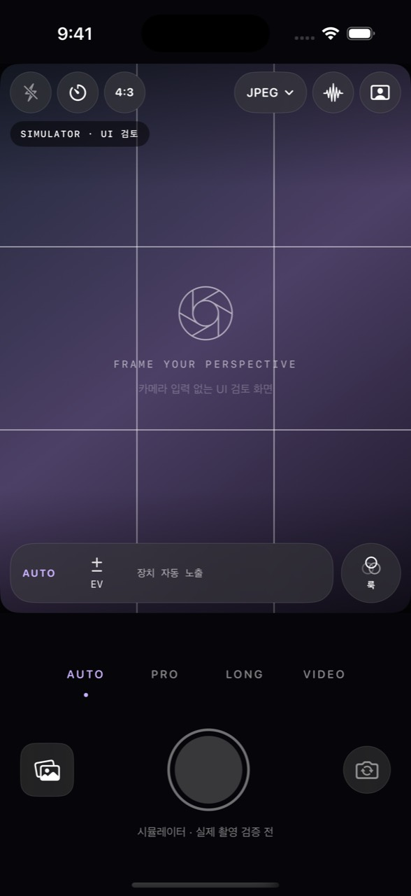
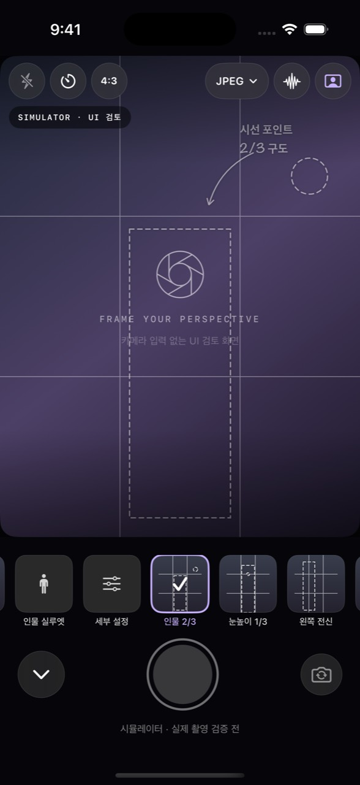
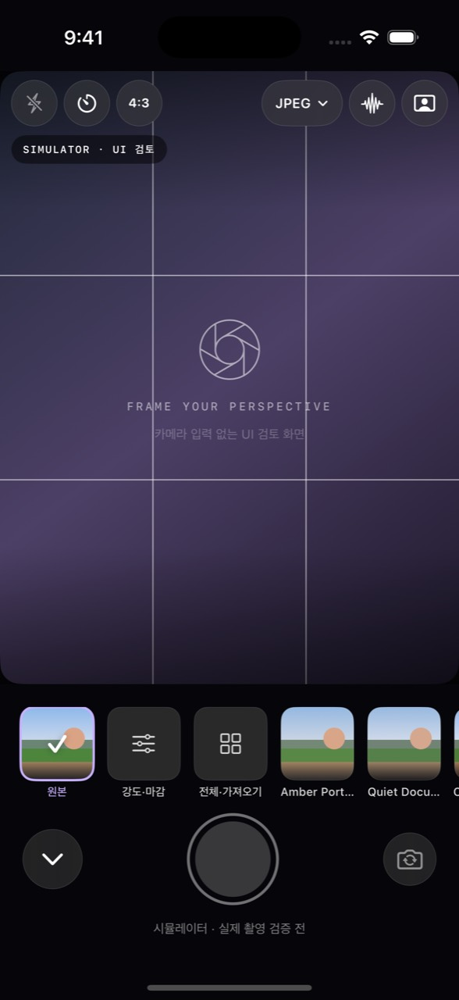
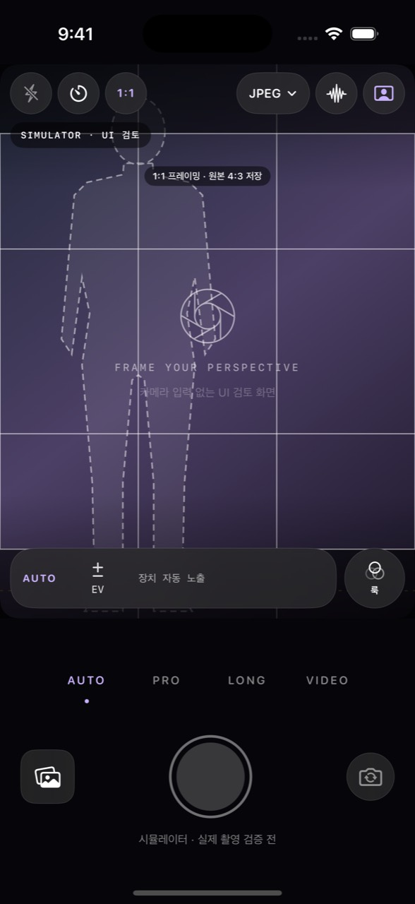

# 촬영 UI 개편 · 2026-10-21

## 구현 범위

사용자가 제공한 보라색 유리 카메라 이미지를 변경 없이 리사이즈하여 iPhone AppIcon(20/29/40/60pt @2x/@3x, App Store 1024px)에 적용했다. 레이어를 분리한 Icon Composer 아이콘은 아니며 원본 정사각 이미지의 흰 배경도 유지한다.

SwiftUI 촬영 화면을 뷰파인더·도구 레일·촬영 도크로 재구성했다. ISO/셔터/EV/WB/초점은 아이콘을 눌러 같은 화면의 패널에서 선택·슬라이더로 조절한다. 슬라이더를 놓으면 기존 AVFoundation 서비스에 설정을 적용한다. 자동/수동/잠금 조합은 상호 배타적이며 카메라의 실제 지원 범위를 조회한다. UI 표시값은 요청값과 실시간 readout을 구별한다.

상단 포맷 버튼에서 HEIF/JPEG, 지원 RAW 모드, 현재 포맷의 해상도 상한, 브래킷을 변경한다. 구도와 모니터도 촬영 화면 패널에서 조정한다. LUT 강도·원본 비교·필름 마감은 같은 화면에서 조절하며 파일 가져오기/전체 스타일 탐색, 장노출의 작업 진행·재처리, 사진 편집/기록은 별도 화면을 유지한다. 지원하지 않는 RAW 조합은 추가하지 않는다. 플래시·배율·디지털 줌은 아래 2차 개편에서 장치가 보고하는 범위로만 추가했다.

## 참고 자료와 적용

- [Apple HIG · Materials](https://developer.apple.com/design/human-interface-guidelines/materials): 콘텐츠 위의 조작 계층에 재질을 사용한다.
- [Apple Design Resources](https://developer.apple.com/design/resources/): 공식 UI Kit, Camera Control 템플릿 및 시스템 글꼴/심볼을 검토했다. Figma/Sketch 원본 템플릿을 앱 자산으로 복사하거나 편집했다고 주장하지 않는다. 구현은 SwiftUI 기본 컨트롤과 SF Symbols를 사용한다.
- [Applying Liquid Glass to custom views](https://developer.apple.com/documentation/SwiftUI/Applying-Liquid-Glass-to-custom-views): iOS 26+ 및 지원 SDK에서 `.glassEffect(.regular)`를 사용한다. iOS 17~25/이전 SDK는 `.ultraThinMaterial`로 대체한다.
- [Apple HIG · Buttons](https://developer.apple.com/design/human-interface-guidelines/buttons): 빈번한 조작의 터치 영역 44pt 이상, VoiceOver 레이블/값, 투명도 줄이기와 동작 줄이기를 반영한다.

색상은 아이콘의 연보라색을 활성 상태에만 사용한다. 촬영 영상에는 착색 레이어를 씌우지 않는다. 프리뷰는 3:4 aspect-fit을 유지한다. 패널을 열 때도 셔터와 하단 도구의 위치는 바뀌지 않는다.

## 검증 계획과 제한

- `CameraChromeTests`: 로그 ISO/셔터 스케일의 왕복 정확도, 선형 EV, 단일 하드웨어 값, 범위 제한 및 셔터 문자열.
- `CameraInteractionTests`: 네이티브 앱 실행, 구도/ISO/포맷 패널의 열기·닫기, 촬영 버튼 유지 및 시뮬레이터에서 촬영 불가 확인.
- GitHub macOS CI에서 iPhone SDK 빌드, 전체 단위 테스트, UI 테스트, `simctl` 화면 캡처 및 xcresult 저장.
- `--ui-review`는 Debug 시뮬레이터에서만 사용하는 검토 옵션이다. 카메라 세션을 시작하지 않으며 합성 배경에 UI 검토임을 표시한다. 캡처는 실제 SwiftUI 앱 실행 화면이고, 실기기 카메라 영상·촬영 품질 검증은 아니다.
- 기존 실제 카메라 권한·수동 설정·RAW·장노출·LUT의 하드웨어 검증은 iPhone에서 별도로 수행해야 한다.
- CI 결과는 실행 후 기록한다. 디자인 목업이나 렌더링만으로 실제 앱 테스트를 대체하지 않는다.

## 실행 결과와 화면

최초 macOS runner 미배정 실패는 재시도 후 해소되었다. `ea12093`의 실행39575774557에서 iPhone SDK·Swift142·UI1·Python13은 성공했고, 별도 캡처 단계가 Shutdown 상태를 만나 실패했다. UI 테스트의 xcresult에서 실제 화면을 회수했으며 캡처 전 boot/bootstatus 처리를 추가했다.

`7a15e0d`의 실행39579967039에서 SDK·Swift149·UI1·Python17, 원본/복사 앱의 LUT30개 검사, 기본/구도 화면 캡처가 모두 성공했다. 기본 격자와 구도 선택 상태를 통일한 최종 코드 `6c569e0`의 [실행39581407493](https://github.com/MetaParodica/PhotoP/actions/runs/39581407493)도 **SDK·Swift155·UI1·Python17·자산 검사·캡처 전체 성공**이다. UI 테스트는 삼분할→숨기기→삼분할과 패널 닫기/다른 도구 열기를 실제로 조작했다.

캡처는 iPhone16 Pro/iOS18.5 Simulator, Xcode16.4에서 `simctl`로 얻은 실제 SwiftUI 앱 화면이다. PNG 원본과 보기용 JPEG를 보관하고 코드/CI/해시를 `screenshots/provenance.json`에 기록했다. 이 환경에서는 iOS17~25용 system material fallback을 실행했으며 iOS26 native Liquid Glass 분기는 미검증이다. 실제 iPhone 촬영 영상이나 실기기 품질 승인이 아니다. 검토용 합성 배경은 화면에 명시한다.

| 기본 촬영 화면 | 구도 패널 |
| --- | --- |
|  |  |

이번 변경은 [Draft PR #2](https://github.com/MetaParodica/PhotoP/pull/2), `codex/camera-ui-refresh`에 보관한다. 이후 실제 iPhone의 지원 범위/파일·메타데이터/Photos·패널 터치/접근성·촬영 중단을 검증한다.

## 2차 개편 · 사진 중심 (2026-10-21)

- **뷰파인더 확대:** 좌우 여백을 없애 화면 너비 전체를 쓰고, 헤더(플래시·타이머·프레이밍·포맷·보조·가이드)와 줌/조절 레일을 뷰파인더 위에 반투명 그라데이션과 함께 띄운다. 높이가 부족한 기기에서는 하단 촬영 도크(약 190pt)를 보장하도록 폭을 줄인다. 3:4 aspect-fit과 촬영 범위는 그대로다.
- **인물 가이드:** 전신·무릎 위·허리 위·가슴 위·얼굴 프레이밍, 왼쪽 1/3·중앙·오른쪽 1/3 위치, 1~3명을 흰 점선 실루엣으로 표시한다. 전신은 발끝선, 그 외는 눈높이선을 함께 그리고 프레이밍별 촬영 팁을 패널에 보여 준다. AI 제안을 켜면 Vision 어깨 폭·코 위치를 목표와 비교해 "화면 왼쪽으로", "더 크게" 같은 화면 기준 이동 방향을 표시한다. 실루엣은 자체 제작 도식이다. 요청된 YoungPhoto 앱의 실제 화면·자산은 확인하거나 복사하지 않았고, 포즈 가이드 앱에서 공통으로 쓰는 실루엣 오버레이 방식만 참고했다.
- **최근 촬영 확인:** 왼쪽 아래 버튼이 마지막 원본의 썸네일(ImageIO, 240px)을 보여 주고, 누르면 최근 촬영 화면(2048px 미리보기, 실제 확장자·해상도, 사진 앱 저장 상태, 공유·저장·편집, 브래킷 원본 전환, 편집 기록·영상 보관함)이 열린다.
- **줌:** 렌즈 버튼은 후면 광각 대비 화각(`videoFieldOfView`)에서 계산한 배율(0.5×/1×/3× 등)로 표시한다. 같은 렌즈 안의 디지털 줌은 핀치와 `D` 버튼(1→2→4×)으로 조절하며 최대 5×, 노란색 `D n×`로 구분한다. RAW는 디지털 줌을 적용하지 않으므로 1×가 아니면 촬영을 막고 이유를 표시한다. 렌즈 전환 시 1×로 돌아간다.
- **플래시·타이머·프레이밍:** 플래시는 `supportedFlashModes`에 있는 모드만 순환하고 브래킷·RAW에서는 끈다. 셀프타이머는 끔/3초/10초이며 카운트다운 중 셔터를 다시 누르면 취소한다. 1:1·16:9는 바깥을 어둡게 하는 **프레이밍 가이드**이고 저장 원본은 4:3이다(라벨로 명시).
- **자주 쓰는 설정:** 포맷 버튼은 메뉴로 HEIF/JPEG/RAW를 바로 고르고, 해상도·브래킷은 "상세 설정"으로 연다.
- **룩 분리·AUTO/PRO 구분:** 룩은 레일 오른쪽의 별도 원형 버튼이다. AUTO 레일은 EV와 읽기 전용 ISO·셔터·색온도만 보여 주고, PRO는 ISO·셔터·EV·WB·초점 조절을 펼치며 수동(M)·잠금(L) 표시를 붙인다. 패널에서 수동 노출을 고르면 PRO로 전환된다.
- **실기기 대기:** 렌즈 배율 값, 핀치 반응, 플래시/전면 Retina Flash, 타이머 촬영, 썸네일 지연, 인물 피드백 정확도는 실제 iPhone에서 확인해야 한다.

## 3차 · 주석형 구도 가이드와 하단 카드 선택

- **주석형 구도 프리셋 12종:** 사용자 제공 참고 이미지(『영보또의 사진 클래스』 예시 사진과 카드형 카메라 화면)의 표현 방식을 따라 흰 3분할선, 점선 주제 영역, 점선 원 시선 포인트, 점선 연결선, 손글씨체(Noteworthy) 메모와 곡선 화살표를 그린다. 인물(2/3·눈높이 1/3·왼쪽/오른쪽 전신·인물+랜드마크), 음식·정물(삼각·세로 삼각·대각 포인트), 공간(조명 삼각), 풍경(반영·하늘 2/3·프레임 속 프레임). 좌표·문구·도형은 자체 작성했으며 책·앱의 이미지나 원본 자산은 포함하지 않는다.
- **인물 프리셋 피드백:** AI 제안을 켜면 Vision 관절 범위로 인물 높이·중심·머리 위치를 점선 영역과 비교해 이동 방향을 표시한다.
- **하단 카드 선택:** 헤더의 가이드 버튼과 레일의 룩 버튼은 모드 줄 자리에 가로 카드 목록을 연다(64pt 썸네일, 선택 시 체크·보라 테두리, 왼쪽 아래 `⌄`로 닫기). 같은 `CameraCarousel` 컴포넌트를 구도와 룩에 사용한다.
  - 구도: 가이드 끔 · 인물 실루엣 · 세부 설정 · 프리셋 12종(썸네일은 같은 도형을 축소 렌더링).
  - 룩: 원본 · 강도·마감 · 전체·가져오기 · PhotoP 컬러 스타일 24종(생성 색상표 썸네일) · 공간 효과 8종. 외부 LUT는 sRGB 해석 확인이 필요하므로 "전체·가져오기"에서 고른다.
  - 룩 카드 전환은 프리뷰를 다시 만들되 히스토그램·Zebra·피킹·AI 가이드 설정은 유지한다.
- 한 번에 하나의 가이드 계열만 그린다. 프리셋을 고르면 기본 격자·인물 실루엣·포즈 골격을 끄고, 패널에서 격자나 실루엣을 고르면 프리셋을 해제한다.

### 2·3차 실행 결과와 화면

`7384cfa`의 [실행39614392835](https://github.com/MetaParodica/PhotoP/actions/runs/39614392835): iPhone SDK·Swift186·UI5·Python17·자산 검사·화면 캡처 성공. 중간 실패는 화면 밖 카드 탭과 썸네일의 중복 접근성 ID(UI 테스트), 20분 작업 제한 초과였고 각각 테스트 조정·썸네일 접근성 숨김·35분 제한으로 해결했다. 아래는 Debug 시뮬레이터 합성 배경의 실제 앱 화면이며 실기기 촬영이 아니다. 이전 1차 PNG 캡처는 현재 UI와 달라 제거했다.

| 기본 | 구도 카드(인물 2/3) | 룩 카드 | 인물 실루엣·1:1 |
| --- | --- | --- | --- |
|  |  |  |  |

