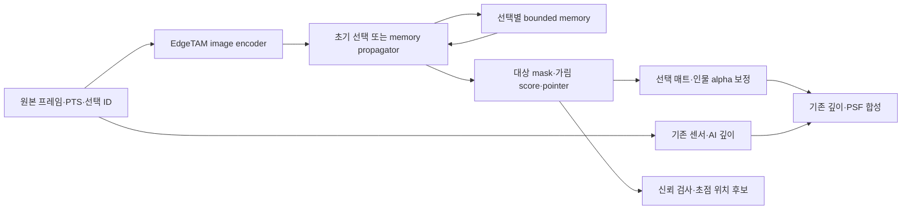

# 외부 AI 전체 추적 모델 도입 조사

2026-11-20 KST. 기준 main `b4ba1943b206cb4bffd99fd5a8d5a21c45ec5299`. 사용자 기기: iPhone 15 Pro / iOS 27.2. [기존 구현44](44-COMPUTATIONAL-DEPTH-IMPLEMENTATION.ko.md)의 encoder-only 변환 이후, 실제 영상 마스크 추적 전체를 도입할 경로를 조사했다. 이번 변경은 조사·참조 실행·기록이며 앱에 새 모델을 넣은 작업이 아니다.

후속 사용자 결정은 [46 실험적 기능 기획](46-EXPERIMENTAL-AI-DEPTH-PLAN.ko.md)이 우선한다. 기존 심도/AI/추적/편집은 기본 기능으로 유지하고 **이번 신규 외부 AI 기능만** 실험실 기본Off·설정 활성화로 제공한다. 사진 전용 신규 기능은 사진부터 독립 구현한다. 아래의 “저장 영상 우선”은 조사 당시 권고이고, 현재 구현 순서는46의사진→저장영상→라이브로 조정한다. 기술적 한계·출처·실제 검증 범위는 유지한다.

## 1. 결론과 이전 권고에서 달라진 점

**범용 대상 추적의 첫 도입 PoC는 EdgeTAM 전체 영상 경로로 변경하는 것이 타당하다.** 기존 EfficientTAM을 폐기하지 않고 참조/차선 후보로 유지한다. EdgeTAM은 공식 iPhone 성능 자료 외에도, 메모리까지 포함하는 커뮤니티 Core ML 변환 두 종류가 공개되어 있어 남은 변환 작업을 줄일 수 있다. 단, 기존 패키지를 그대로 배포할 품질 검증은 충족하지 않았다.

**인물 경계에는 MatAnyone 2의 별도 PoC를 병행할 가치가 있다.** 2026년 공개된 공식 후속 모델과, 공식 README에서 소개하는 외부 Swift/Core ML 포트를 확인했다. 사람용 alpha 매팅이므로 동물·상품·식물 등 범용 추적을 이것 하나로 대체할 수 없다.

우선순위는 `저장 영상의 단일 선택 대상 → 실기기 정확도/성능 확인 → 라이브 선택 대상 → 인물 경계 고품질 옵션`이다. 초기부터 여러 대형 모델을 매 프레임 함께 돌리거나 녹화 해상도·프레임레이트를 임의로 낮추지 않는다. **앱 채택 확정은 iPhone의 전체 경로 검증 뒤에 한다.**

## 2. 현재 PhotoP와 필요한 교체 범위

| 현재 실제 코드 | 하는 일 | 외부 모델로 보완할 부분 |
|---|---|---|
| `SubjectTrackingAnalyzer.swift` / `SubjectTrackingVisionEngine.update` | Vision 사람/얼굴 검출 후 `VNTrackObjectRequest` bbox 추적, 선택 ID·generation·신뢰 상태 관리 | 프레임을 넘어 같은 대상의 픽셀 마스크를 기억하는 신경망 메모리는 없음. 현재 `.lost`는 자동 재식별로 복구하지 않음 |
| `DepthMatteRefiner.refine` | 해당 초점 위치의 Vision instance를 프레임마다 선택하고 color-line 경계 보정 | bbox 안 중심이 배경/가림 물체에 들어가거나 유사 대상이 교차할 때 ID와 마스크가 달라질 수 있음 |
| `VideoDepthStabilizer` | 이전 깊이를 flow로 등록하고 잘못된 history 폐기 | 대상의 장기 외형 기억과 가림 후 재등장은 처리하지 않음 |
| `ExternalDepthEstimator` / `NaturalDepthEngine` | 깊이 추정과 PSF/가림을 고려한 합성 | 추적 모델의 mask로 깊이를 대체하지 않고 기존 깊이·렌더러에 연결 |
| `VideoDepthProcessor.render` | 원본 hash·PTS·오디오·방향 보존, 별도 SDR 영상 | 순차 프레임 추적 어댑터를 연결할 첫 통합 위치 |

현재 bbox/flow/instance 분석은 기존 구현으로 유지할 수 있는 기반이다. 외부 전체 추적을 넣는 핵심은 **선택한 대상의 마스크·가림 상태·객체 포인터·시간 메모리를 함께 유지하는 것**이다. AF 렌즈 구동, 정확한 거리, 모발 alpha, 광학 보케는 이 모델의 출력 자체가 아니다.

## 3. 공식 모델과 포트 비교

아래 속도·품질은 별도 표시한 자체 CPU 참조 외에는 **저자/포트 작성자의 공개 결과**다. 기기·해상도·측정 범위가 달라 행끼리 직접 순위를 매기지 않는다. 고정 SHA·읽은 파일·가중치/문서 hash는 [출처 레지스트리](research/tracker-adoption/sources.json)에 있다.

| 후보 / 직접 확인한 출처 | 적합한 역할 | 공개 도입 근거와 한계 | PhotoP 권고 |
|---|---|---|---|
| [EdgeTAM 공식](https://github.com/facebookresearch/EdgeTAM/tree/7711e012a30a2402c4eaab637bdb00a521302c91) | 클릭/박스 기반 임의 객체 영상 마스크 추적 | RepViT·2층 memory attention·spatial perceiver, 1024². 공식 표는 iPhone 15 Pro Max 영상15.7fps, 정지 이미지40.4fps. 공식 Core ML 스크립트는 전체 영상 경로가 아님 | **범용 추적 1순위 PoC** |
| [EfficientTAM 공식](https://github.com/yformer/EfficientTAM/tree/abcd061ebd3cc6e7527d152d75b890126aaa53f6) | 작은 ViT 기반 범용 마스크 추적 | 저자 iPhone 15 >10fps. 기존 Tiny512 encoder 변환 성공, 이번 전체 CPU 3프레임 참조 성공. decoder/메모리 Core ML 경로는 여전히 자체 검증 필요 | 기존 자산·참조 유지, 차선 비교 |
| [SAM 2.1 공식](https://github.com/facebookresearch/sam2/tree/2b90b9f5ceec907a1c18123530e92e794ad901a4) / [Apple Tiny Core ML](https://huggingface.co/apple/coreml-sam2.1-tiny/tree/39ae0a8a83e5e6cd196e804bf7cccc5f8171f306) | 범용 마스크/재교정, 품질 참조 | Tiny38.9M parameters. Apple 공개3패키지는 image/prompt/mask이며 영상 memory 모듈은 없음. 공개 GPU FPS를 iPhone 성능으로 해석하지 않음 | 품질 기준·프롬프트 참조 |
| [SAM 3 / 3.1 공식](https://github.com/facebookresearch/sam3/tree/31cb7e624e4fe95301b1be1d4e809111593d2e45) | 텍스트 개념의 모든 객체 검출·분할·다중 추적 | 3.1 Object Multiplex는2026-03-27 공개. H100/128객체의 약7배 개선은 단일 객체 iPhone 성능이 아님. 공식 Python/CUDA 경로·가중치 접근 신청 필요, 자체 iOS 변환 없음 | 오프라인 품질 참조, 1차 라이브 도입 후순위 |
| [Cutie](https://github.com/hkchengrex/Cutie/tree/ec5cdd4cf16f75c73ad785a2f96fb97dbad4125a) | seed mask를 받아 객체 기억·가림 대응 | 실제 `InferenceCore.step`, working/long-term memory 관리 코드 공개. 시작 마스크가 필요하고 자체 Core ML/단말 성능 검증 없음 | bounded memory·교정 참조/차선 PoC |
| [XMem](https://github.com/hkchengrex/XMem/tree/f3b841d50df058910bbf690229ddc15fb1aef7d6) | 긴 영상의 단기/장기 메모리 | 10,000프레임 이상·약20fps 소개는 저자 GPU 조건. 마스크 초기화·별도 변환 필요 | 메모리 정책 참조 |
| [MatAnyone](https://github.com/pq-yang/MatAnyone/tree/e5ddc534c1fff9bb9e54cf476095d29071b7cb4f) / [MatAnyone 2](https://github.com/pq-yang/MatAnyone2/tree/0079197acd6d16a741f71558809c06c586c579e0) | 선택 인물의 시간적으로 안정된 alpha | MatAnyone 2는 CVPR2026, first-frame 인물 mask 필요. quality evaluator의 checkpoint/training과 VMReal은 공식 TODO에서 미공개 상태 | **인물 경계 1순위 비교** |
| [RVM](https://github.com/PeterL1n/RobustVideoMatting/tree/53d74c6826735f01f4406b5ca9075eee27bec094) | 인물 recurrent alpha·foreground | MobileNetV3·ONNX/TorchScript 제공, 저자의4K76fps는 GTX1080Ti. 임의 물체나 특정 인물 ID를 선택하는 범용 추적 아님 | 가벼운 인물 기준선 |
| [CoTracker3](https://github.com/facebookresearch/co-tracker/tree/82e02e8029753ad4ef13cf06be7f4fc5facdda4d) | 가림을 포함한 점 궤적·가시성 | 온라인 window 지원. 점 궤적은 대상 마스크/alpha/깊이와 다른 출력 | 보조 움직임 검증, 1차 엔진 제외 |

## 4. EdgeTAM 공식 Core ML 예제를 그대로 쓰면 안 되는 이유

[공식 exporter](https://github.com/facebookresearch/EdgeTAM/blob/7711e012a30a2402c4eaab637bdb00a521302c91/coreml/export_to_coreml.py)와 [실행 예제](https://github.com/facebookresearch/EdgeTAM/blob/7711e012a30a2402c4eaab637bdb00a521302c91/coreml/inference_example.py)를 README 설명과 대조했다.

1. 세 패키지는 image encoder·prompt encoder·mask decoder다. **memory encoder·spatial perceiver·memory attention·객체 포인터 유지가 빠져 있다.** 실행 예제는 움직이지 않는 `tracking_points`를 다음 프레임에도 사용한다. 완전한 시간 메모리 추적과 다르다.
2. prompt wrapper는 `boxes`, `mask_input`을 인자로 받지만 내부에서는 `boxes=None`, `masks=None`을 전달한다. 인터페이스 이름만 보고 박스·이전 마스크 교정이 된다고 판단하면 안 된다.
3. `multimask_output[0].item()`을 Python 조건으로 바꿔 tracing한다. 입력 boolean으로 실행 시 분기를 자유롭게 전환하는 그래프라고 볼 수 없다. pointer/가림 object score도 출력하지 않는다.
4. image input은 `/255`, bias0인데 공식 `SAM2Transforms`는 mean `[0.485,0.456,0.406]`, std `[0.229,0.224,0.225]` 정규화를 한다. 해당 wrapper에서 같은 정규화가 들어가는지부터 parity로 검증해야 한다.
5. Core ML README의39.2ms 수치는 별도 synthetic 이미지 benchmark다. 코드에서 **image encoding을 한 번만 수행한 후 prompt+decoder를 측정**하므로 영상 한 프레임 전체 비용으로 사용할 수 없다.

공식 연구 모델의16fps 주장 자체를 위 예제가 재현했다는 뜻은 아니다. 전체 경로 변환을 별도로 확보해야 한다.

## 5. 이미 공개된 전체 EdgeTAM Core ML 경로

### 5.1 AhmadYarAI 커뮤니티 패키지

[고정 revision `6bfdd476`](https://huggingface.co/AhmadYarAI/EdgeTAM-CoreML-Video/tree/6bfdd4765e42508c7707566fff52e65add8b8e3a). Meta 공식 배포가 아니다. image encoder·initializer·memory encoder·propagator 네 패키지가 있다.

README만 확인한 것이 아니라 **네 `model.mlmodel` protobuf를 실제 내려받아 입력·출력을 읽었다.** `spatial_bank [1,7,512,64]`, `spatial_positions [1,7,512,64]`, `pointer_bank [1,16,256]`, `attention_bias [1,1,1,3648]`, `rotary_weight [1,1792]` 입력이 존재한다. initializer point는 `[1,1,2]`로 단일 클릭 형태다. 모델 specificationVersion9. [실제 인터페이스 기록](research/tracker-adoption/coreml-model-interfaces.json)에 Apple Tiny3개와 함께 보존했다.

작성자는 iOS18+, `.cpuAndGPU` 권장, 8프레임 표본의 mask IoU 약0.9256~0.9794를 공개한다. 이는 변환 전후 유사도 표본이며 사람 GT에 대한 정확도가 아니다. 가중치 전체/실행은 이번에 내려받거나 검증하지 않았다.

### 5.2 Jutsu의 재현 가능한 전체 변환

[고정 SHA `3c36c37f`](https://github.com/jutsuhq/edgetam-coreml/tree/3c36c37f93a3106375aa33c14fd7ec426b9e1fa9). 공식 모델을 가져와 직접 재변환하는 코드와 parity/speed 원시 JSON이 있다. **1차 PoC의 변환 출발점으로 권고**하되 기본 release를 그대로 채택하지 않는다.

| 네 패키지 | 기능 / 공개 조건 |
|---|---|
| ImageEncoder | 1024² RGB→raw/initial 특징·고해상도 특징. 평균/표준편차 정규화를 그래프에 포함 |
| Initializer | 1~16 양성/음성 point·box corner·mask 교정, 3개 후보/IoU/pointer/object score. FP32 기본 |
| MemoryEncoder | seed mask/원래 특징→compressed spatial memory·position·temporal position |
| Propagator | 현재 특징+고정 bank→마스크·가림 score·pointer·다음 memory. per-frame memory encoder/attention/perceiver 포함 |

주요 확인 사항:

- upstream EdgeTAM SHA와 checkpoint SHA를 고정한다. 이번 공식 checkpoint **56,116,523bytes**를 실제 다운로드하여 `ed2d4850b8792c239689b043c47046ec239b6e808a3d9b6ae676c803fd8780df` 일치를 확인했다.
- RoPE는 고정 실수 sin/cos 연산으로 표현하고, 선택 분기/argmax를 변환 가능한 연산으로 풀어낸다. 빈 슬롯을 처리하는 `--mask-empty-slots` 경로는 명시적인 `softmax(QKᵀ/√d + bias)V`를 사용한다.
- 기본 빌드는 빈 슬롯을 attention에 포함하며 `attention_bias` 입력도 읽지 않는다. 0으로 채운 슬롯은 projection bias 때문에 의미적으로 무효가 아니다. **첫1~6프레임 memory·1~15프레임 pointer가 채워지는 동안 원본 모델과 달라질 수 있다.**
- 고정 bank는 conditioning seed1개를 보존하는 형태다. 여러 클릭을 같은 seed에서 처리하는 것과 서로 다른 시점의 여러 conditioning frame을 원본 predictor처럼 유지하는 것은 다르다. 중간 교정은 우선 해당 시점에서 새 seed/replay로 정의하고, 다중 conditioning 지원은 별도 참조 검사를 한다. 빈 슬롯 판단도 일반적인 all-zero 추측보다 앱이 관리하는 명시적 validity와 대조한다.
- 작성자의 ANE `SDPA.attn_mask` 관측은 특정 runtime/기기의 실험이다. Apple 전체 버전의 보장된 동작이나 PhotoP가 재현한 버그로 표기하지 않는다. CPU/GPU/ANE 각각 mask를 바꿔 출력이 바뀌는지 직접 검사해야 한다.
- 실제 `results/speed.jsonl`은 **Apple M4**, encoder median14.23ms + propagator34.96ms =49.19ms 모델 시간이다. **iPhone 15 Pro 측정도, 색 변환·깊이·매팅·보케·화면 합성까지 포함한 지연도 아니다.** initializer FP32는 `.all` GPU12.3ms, `.cpuAndNeuralEngine` CPU44.15ms로 작성자가 기록했다.
- 기본 패키지 크기 합계 약69MB, initializer FP32/나머지 FP16. `minimum_deployment_target=macOS15`로 생성하므로 PhotoP에서는 iOS18 target으로 재생성·기기 로드를 확인한다. 파일 크기를 실행 중 peak memory로 해석하지 않는다.
- v1.2 기본 ZIP 및 별도 masked propagator ZIP이 공개되어 있다. GitHub 제공 asset digest는 레지스트리에 연결된 release metadata에서 확인했으며 이번에 ZIP 자체를 다운로드/검증하지 않았다.

**가장 중요한 제한:** 공개 `parity-fp16-ane-masked-vs-stock.json`의 `pass`는 **false**다. mask 최소 IoU 약0.900, 평균 약0.991이지만 모든 프레임에서 mask≥0.95·memory/pointer cosine≥0.99라는 작성자 조건을 만족한 시퀀스는0/5다. FP32 masked CPU도4/5만 개별 조건을 만족하고 전체 `pass=false`다. 평균 수치만 보고 채택 완료로 판단할 수 없다. 또한 대부분 같은 bedroom 영상의 서로 다른 대상/구간이므로 독립적인5종 실사 검증을 대체하지 못한다.

권고는 **masked 경로 + FP32 기준선 → 혼합 정밀도별 오류 위치 확인 → A17 Pro 검증**이다. 원본 모델과의 수치 일치와 실제 사람/물체 GT 품질을 따로 평가한다. 양자화·가중치 압축은 초기 범위에서 제외한다.

### 5.3 Apple Tiny/간단한 Swift 추적 예제와 구별

Apple 계정의 SAM2.1 Tiny 세 protobuf도 실제 읽었다. memory/pointer 입력 없는 이미지 분할 패키지다. [arraypress Swift 예제](https://github.com/arraypress/swift-object-cutout/blob/4b524abf8f5e2ced7b1f85137fb0f6674a36ff01/Sources/ObjectCutout/ObjectTrack.swift)는 이전 마스크 centroid를 다음 이미지 클릭으로 전달하며 실패를 거부한다. 유용한 경량 접근이지만 SAM2의 학습된 영상 메모리 전체를 돌리는 경로로 분류하지 않는다. [mikeesto 예제](https://github.com/mikeesto/sam2-coreml-python/tree/694b5acff222c418aa236fd9082845e02c450891)도 완전한 temporal 모델을 확보했다는 근거로 사용하지 않는다.

## 6. EfficientTAM에서 실제로 더 확인한 범위

기존 [encoder-only 결과](research/2026-11-20-efficienttam-encoder-probe.json)는 그대로 유효하다. 이번에는 고정 원본·실제 Tiny512 checkpoint로 image→prompt/mask→memory write→다음 프레임 memory attention의 **전체 PyTorch CPU 참조**를 실행했다.

- 합성3프레임, 첫 프레임 양성 point1개, 이후 추가 prompt 없음. memory encoder3회·memory attention2회 호출과 모든 기록 tensor의 finite를 확인했다.
- image feature `[1,256,32,32]`, low-res mask `[1,1,128,128]`, memory `[1,64,32,32]` 확인. 두 후속 attention의 memory 길이는 객체 pointer를 포함해1028→2056 tokens로 증가한다. 하나의 tracing 길이만 고정하면 다른 단계의 동작을 빠뜨릴 수 있다.
- parameters: image encoder6,163,840 / memory attention5,922,304 / memory encoder1,384,608 / mask decoder4,190,437 / prompt encoder6,220. encoder 변환만으로 남은 연산이 작다고 볼 수 없다.
- [재현 스크립트](research/tracker-adoption/probe_efficienttam_reference.py)·[실제 출력/모듈 입출력](research/tracker-adoption/efficienttam-reference.json) 보존. PyTorch2.5.1+cpu,2 threads. 기록된 각1회 CPU 시간은 성능 benchmark가 아니다.

```bash
# 기존 encoder probe와 같은 격리 환경/고정 checkout/checkpoint를 사용한다.
python docs/research/tracker-adoption/probe_efficienttam_reference.py \
  --source /path/to/EfficientTAM \
  --checkpoint /path/to/efficienttam_ti_512x512.pt \
  --output /tmp/efficienttam-reference.json
```

이 검사는 메모리 연결과 변환할 tensor 계약을 확인한다. 합성 사각형의 실제 추적 정확도, Core ML decoder/memory 변환, Apple runtime parity, ANE 배치, 가림 후 ID 유지 성공은 증명하지 않는다. **EfficientTAM 전체가 앱에 들어갔다고 상태를 바꾸지 않는다.**

## 7. 인물 경계: MatAnyone 2와 Swift 포트

[공식 MatAnyone 2](https://github.com/pq-yang/MatAnyone2/tree/0079197acd6d16a741f71558809c06c586c579e0)는 기존 segmentation 같은 뭉친 경계를 줄이고 안정된 인물 매팅을 목표로 한다. 첫 인물 mask를 입력받는 구조라 EdgeTAM 선택 mask와 역할이 이어진다. 공식 README가 [MatAnyone2Kit](https://github.com/flowtyone/MatAnyone2Kit/tree/d85a029870b5149af6aa122cbc13c90db11e5b35)를 **third-party** 포트로 소개한다. 소개는 공식 성능 인증을 뜻하지 않는다.

직접 읽은 Swift/변환 코드:

- encoder·readout·decoder·uncert·maskencoder·objsummary의 **6개 Core ML 모델**, Swift의 memory bank/affinity/top-k/sensory state. 핵심 Swift 코드와6개 compiled model의 metadata·manifest를 확인했다. 모델 가중치/compiled 전체를 실행하지 않았다.
- 포트의 공개 주장은 **iPhone16/A18·288×512·인물1명·30fps**다. PhotoP의 iPhone15Pro/A17 Pro·깊이+보케 동시 실행·가로·4K 녹화 성능으로 환산할 수 없다. Swift memory matching 등 CPU 연산도 있어 전체 파이프라인이 모두 ANE에서 돈다는 뜻은 아니다.
- 최상위 facade는 Vision의 가장 큰 인물 박스로 seed하고, 실패 시 전체 person mask로 fallback할 수 있다. PhotoP는 **사용자가 선택한 사람의 mask**를 저수준 `seed(image:seedMask:)`에 넘겨야 한다. 가까운 다른 인물로 자동 교체하는 동작은 가져오지 않는다.
- `seed` 기본 warmup은 같은 첫 이미지를10번 처리한다. 초기 탭 반응·취소·선택 generation을 별도로 다루고 이 내부 반복을 실제 영상10프레임으로 계수하지 않는다.
- facade 출력은 `OneComponent8` alpha다. 품질 우선 경로는 저수준 `[Float]` alpha를 유지하고 최종 합성까지 불필요한8bit 왕복을 피하는 adapter를 검토한다.
- 고정 portrait288×512와 full-frame 비등방 resize를 사용한다. 원본의 가로/회전/미러·선택 좌표·종횡비를 재검증하고 landscape/사진용 다른 고정 shape는 재변환 대상으로 둔다. 64MP 사진에288×512 결과만 키워 붙이는 것을 고해상도 경계 해결로 선언하지 않는다.
- Package는 iOS17/macOS14를 표시하지만 exporter는 **`ct.target.iOS18`**이다. PhotoP 최소18과 맞출 수 있으나 README의17만 보고 호환성을 확정하지 않는다. 미리 컴파일한 `.mlmodelc`도 실제 SDK/기기에서 로드를 검증한다.
- objsummary는 GPU override, 나머지도 실제 compute plan으로 배치를 확인한다. 포트가 권하는720p/60fps 카메라 설정을 PhotoP의 녹화/수동 노출 설정에 그대로 적용하지 않는다. 분석용 다운스케일과 실제 원본 녹화는 독립적으로 설계한다.

먼저 저장 인물 영상에서 기존 Vision+color-line과 MatAnyone2 alpha의 경계·시간 오차를 비교한다. 사람 외 대상, 불확실한 seed, 가림/컷에서는 기존 안전한 fallback을 유지한다. 모델 alpha를 이진 마스크로 처리하거나 모든 경계에 기존 color-line을 다시 강제 적용하는 것은 비교 없이 결정하지 않는다.

## 8. iOS18 기반과 iOS27 선택 경로

Apple 공식 문서도 직접 읽고 hash를 기록했다.

- [MLState](https://developer.apple.com/documentation/coreml/mlstate)는 **iOS18**부터 있다. 상태를 Core ML 내부에 둘 수 있지만, 초기 PoC는 explicit bank로 두어 원본/변환 tensor 비교·선택 교체·취소·프레임 seek를 쉽게 검증한다. MLState 도입만으로 Swift의 전체 시간 정책이 자동 구현되지는 않는다.
- [MLComputePlan](https://developer.apple.com/documentation/coreml/mlcomputeplan-1w21n)은 iOS17.4부터 지원한다. `.all`/`.cpuAndGPU`/`.cpuAndNeuralEngine`를 모듈별로 실측하며 delegate 분할·전송 비용까지 기록한다. 지정 compute units를 ANE 실행 증거로 쓰지 않는다.
- [Core AI](https://developer.apple.com/documentation/coreai)는 이번 공식 DocC 응답에서 **iOS27.0** 도입이 확인됐다. [통합 문서](https://developer.apple.com/documentation/coreai/integrating-on-device-ai-models-in-your-app-with-core-ai)는 `.aimodel`, AIModel/InferenceFunction, specialization·function loading, 별도 Metal Toolchain을 설명한다. [검증/프로파일 문서](https://developer.apple.com/documentation/coreai/inspecting-debugging-and-profiling-core-ai-models)는 Core AI Debugger의 reference 비교와 Instruments CPU/GPU/ANE trace를 제공한다.
- 따라서27.2는 조사 가능한 상위 경로다. **Core AI 변환·추적 모델 지원·A17 Pro 성능을 실행 검증한 것은 아니다.** 기존26.3/26.6 CI는 SDK27을 검증하지 않는다. 선택 경로를 개발할 때 SDK27 job과 `canImport(CoreAI)`/OS availability를 함께 추가하고 iOS18 Core ML 경로를 유지한다.

1차 배포 기반은 검증 범위가 있는 Core ML/iOS18로 권고한다. Core AI는 같은 참조/품질 gate를 통과해 실제 이점이 확인된 모듈부터 선택할 후속 후보로 둔다.

## 9. PhotoP 통합 설계안



### 모델 계약과 상태

`TrackedMaskFrame`에 선택 UUID/generation, 모델 ID/가중치 hash, 원본 PTS, 원본→모델 좌표 변환, mask logits, object score, 예측 IoU, pointer와 유효 상태를 둔다. 모델의 예측 IoU·object score를 실측 정확도나 보정된 확률로 표시하지 않는다. 모델 메모리는 세션당 단일 직렬 executor/actor가 소유한다.

기존 `SubjectTrackingSnapshot`의 bbox는 mask에서 파생하고 UI·추적 정책과 연결한다. bbox 중심 대신 mask 안의 안정된 내부 지점과 선택/얼굴 anchor를 사용하고, 해당 영역의 신뢰할 깊이를 초점 후보로 삼는다. 깊이의 metric/relative 구분은 유지한다. 터치 AF·AF/AE lock·수동 초점과 자동 추적의 우선순위를 분리하며 모델 centroid가 기존 잠금을 해제하지 않게 한다.

### 가림·재등장·교정

`tracking → occluded/uncertain → reacquiring → tracking`과 최종 `lost`를 구분한다. 짧은 가림에는 같은 대상의 seed/pointer를 보존하되 신뢰가 낮은 결과를 심도/AF에 적용하지 않는다. 나쁜 프레임을 확실한 seed로 승격하지 않으며 원본 모델의 가림 표현과 메모리 갱신을 먼저 재현한다. 비슷한 옆 사람에게 붙는 재식별을 허용하지 않는다. 회복에는 대상 점수·이동/면적·깊이·기억과의 일치가 여러 프레임 연속으로 확인되어야 한다. 실제 임계값은 검증 자료로 정한다.

컷·렌즈/회전/소스 변경·선택 교체에는 해당 generation의 모든 모델 상태를 초기화한다. 잠깐의 가림과 장면 전환을 같은 reset으로 처리해 재등장 기억을 없애지 않는다. 양성/음성 클릭·박스·mask 교정은 같은 영상 시점에 반영하고 이후 checkpoint를 무효화해 재처리한다. 첫 클릭의3개 중첩 후보가 옷만 선택할 수 있으므로 whole-person 선택은 실제 UI/검증 항목으로 둔다.

### 라이브·저장·메모리

- 라이브는 최대1개 실행+최신 pending1개, 무제한 큐 없음. 지연 결과는 PTS/generation으로 폐기한다. 저속 AI의 중간 프레임에 mask를 단순 고정하지 말고 유효한 flow registration이 있을 때만 보간하며, 실패/만료 시 원본으로 돌아간다. 초기10Hz AI 갱신은 **제안 목표**이며30/60fps 카메라 처리 달성 수치가 아니다.
- 저장 영상은 실제 프레임 순서로 매 프레임 처리한다. 처리 속도가 느려도 프레임을 생략하거나 PTS·오디오를 재작성하지 않는다. seek 시 가장 가까운 동일 intent/model checkpoint에서 replay한다. 한 장의 frame preview가 긴 추적 history를 재현했다고 표시하지 않는다.
- EdgeTAM FP16 bank 입력만 이론적으로 **932,992bytes(약0.89MiB)**다. 특징·ring buffer·로짓·initializer FP32 변환·compiled weights·delegate workspace는 별도다. raw/initial/high-res4개 특징만 FP16 약10MiB이므로 bank 크기를 app peak memory로 보고하지 않는다. seed1+최근6 spatial memory와 최근15 pointer를 구분하여 필요한 것만 저장한다.
- 기존 전역 inference gate는 저장 영상 작업이 live를 막지 않게 우선순위·취소 가능한 작업 단위로 재검토한다. 모델 로드/특수화는 화면 스레드에서 하지 않고, memory warning/발열에는 분석 빈도·선택 모듈을 단계적으로 줄인다. 품질 우선 원본/해상도 계약은 유지한다.
- 사진은 live mask를 최종64MP 정답으로 사용하지 않는다. 촬영 원본에서 고품질 mask/alpha를 재추론하고 high-res guidance·타일 합성을 별도로 검증한다. recipe에 model/version/seed/교정을 기록하며 원본 bytes/hash는 유지한다.

## 10. 구현 순서와 완료 조건

| 순서 | 구체 작업 | 다음 단계로 넘어갈 근거 |
|---|---|---|
| T1 고정 참조 | EdgeTAM7711e01 + Jutsu3c36c37f masked 변환을 별도 환경에 고정. 기존/변환 FP32로 같은 프레임·동일 bank 비교 | seed/일반/빈 슬롯/1~7프레임/최대pointer/가림·재등장/교정·동률 후보의 tensor·선택 일치 기록 |
| T2 Core ML 검증 | iOS18 target 재생성, FP32→FP16/혼합 정밀도 순서. CPU/GPU/ANE 독립 검증 | 공개 `pass=false`를 무시하지 않고 어느 층/후보에서 차이가 커지는지 확인, precision별 gate 명시 |
| T3 저장 영상 통합 | 단일 선택 mask adapter, 순차 bank, 가림 상태, 원본 fallback, recipe 모델 hash | 실제 MOV의 PTS/오디오/회전/원본 hash·취소·선택 교체·재편집 회귀 통과 |
| T4 iPhone15Pro | iOS27.2에서 camera+depth+tracker+보케 전체 실행·10분 trace | 모델별/전체 p50/p95·stale율·peak memory·thermal·energy·첫 로드/교정 지연·유사 인물 ID 교체율 확인 |
| T5 인물 alpha | MatAnyone2Kit 저수준 seed·Float alpha/선택·좌표 adapter, Vision 기준선 비교 | 인물 모발/역광/안경·손/가림의 실제 alpha SAD/MSE/gradient/connectivity와 시간적 오차 개선 |
| T6 확대 | 라이브·재등장 UX·선택적CoreAI·고해상도 사진 | 실제 품질 인수 후에만 활성화 범위 확대. 범용 추적과 인물 옵션의 독립 fallback 유지 |

기존 사진100장/영상10종·3명 blind·3기기10분 gate를 대체하거나 낮추지 않는다. 영상에는 유사 인물 교차, 완전 가림 후 재등장, 화면 밖 왕복, 빠른 pan/흐림, 크기/자세 변화, 모발/털, 손·물체 교차, 유리/반사, 저조도·역광, 컷/회전·렌즈 전환을 포함한다. 새 추적 평가는 mask J&F/경계 F·ID switches·false reacquisition·가림 회복 지연·정렬 후 jitter·fallback 비율을 추가하고, 인물 alpha 지표와 깊이/합성 지표를 따로 기록한다.

수치 parity의 초기 제안은 정밀도별 mask IoU≥0.95·memory/pointer cosine≥0.99를 **모든 지정 프레임에서** 확인하는 것이다. 이는 외부 코드가 쓰는 시작 조건이며 PhotoP 실제 화질 기준을 대신하지 않는다. 기준을 만족하지 못하면 실패 원인을 고치거나 정밀도/기능 범위를 조정하고, 평균값으로 통과를 선언하지 않는다.

## 11. 출처·복사·실행 범위

| 대상 | 확인한 조건 / 이번 사용 |
|---|---|
| EdgeTAM·EfficientTAM·SAM2 code/checkpoints | 공식 Apache2 명시. EdgeTAM checkpoint를 `/tmp` 조사용 다운로드; 앱 미포함 |
| Jutsu / AhmadYarAI 변환 | Apache2 LICENSE·NOTICE 확인, 원본 Meta/SAM2 출처 유지. 코드·모델 인터페이스 조사, 앱 복사/통합 없음 |
| Apple SAM2.1 Tiny | Apple HF card Apache2, 고정 revision의3개 모델 spec 조사; 가중치 미다운로드 |
| SAM3/3.1 | 별도 SAM License, Apache2로 분류하지 않음. gated checkpoint 미다운로드 |
| Cutie/XMem | MIT 본체, GUI 등 별도 출처 조건 구분. 연구용 코드 열람 |
| MatAnyone/MatAnyone2 | NTU S-Lab1.0 조건. MatAnyone2 README의 LICENSE 링크와 실제 `LICENSE.txt` 경로 차이 기록 |
| MatAnyone2Kit | Swift GPL3 + bundled weights S-Lab1.0. 두 조건과 상위 출처를 별도로 확인, 조사에서 제외하지 않음 |
| RVM / CoTracker | RVM GPL3, CoTracker 주된 부분CC-BY-NC 및 일부 별도 조건. 이번 앱 미포함 |

사용자가 허용한 라이선스 종류와 무관한 조사 범위로 모두 비교했다. 실제로 이식하면 고정 SHA·변경/복사 파일·원문 조건·LICENSE/NOTICE와 가중치 hash를 개발 일지/고지에 추가한다. 이번에는 외부 구현·신규 가중치를 앱에 복사하지 않았다.

실제 수행:14개 저장소의 SHA/문서·선별 소스 확보, 공식/커뮤니티 Core ML 코드 대조,7개 protobuf 인터페이스 검사, EdgeTAM checkpoint SHA 확인, EfficientTAM 전체 CPU 합성3프레임 참조. Core ML runtime/기기·실사·신규 iOS 빌드는 실행하지 않았다. 앱 소스는 기존 검증된 상태 그대로이며 이번 조사로 이전 CI의 검증 범위가 넓어진 것은 아니다.

**다음 개발 시작점은 정해졌다:** EdgeTAM의 전체 masked 경로를 고정해 FP32 참조와 먼저 비교하고, 저장 영상 단일 대상에 연결한다. 인물의 모발 품질이 병목인 장면에서는 MatAnyone 2 저수준 경로를 독립 비교한다. 새 모델을 모두 함께 묶는 방향은 권고하지 않는다.
