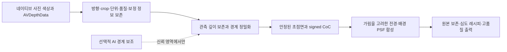

# 네이티브 심도 기반 렌즈 시뮬레이션 — 개선 방향과 개발 순서

> 품질 개선의 후속 상세화: [51 조사](51-DEPTH-QUALITY-RESEARCH.ko.md)와 [52 실행 기획](52-DEPTH-QUALITY-DEVELOPMENT-PLAN.ko.md). 기존 N0~N5를 유지하면서 공개 Apple 비교 필터·MPS 신뢰 경계·초점/가시성·고해상도 저장의 구현 순서와 검증 기준을 구체화했다. 새 앱 구현/기기 인수로 해석하지 않는다.

> 같은 날 후속 개발: [50 1차 구현](50-NATIVE-DEPTH-FIRST-IMPLEMENTATION.ko.md). N1의 자동 AI 분리·심도 프리뷰 예산·native 메타데이터 보존을 로컬에 반영했다. 아래 본문은 개발 전 조사/계획이며 이후 구현·검증 범위는50을 따른다. N0 기기 계측과N2~N5 완료를 뜻하지 않는다.

2026-11-25 KST. main `7f0f6c0` / 앱 소스 `19b343a`를 직접 읽고 사용자의 발열·아웃포커스·추적 피드백을 반영했다. **분석·개발 계획이며 앱 수정이나 발열/화질 개선 완료 보고가 아니다.** [조사 근거](research/2026-11-25-native-depth-sources.json), [당일 일지](development-log/2026-11-25.md).

## 1. 최신 개발 결정

**아이폰의 공개 촬영 API로 얻는 네이티브 심도를 중심으로 자체 렌즈 시뮬레이션을 가장 깊게 개발한다.** 센서와 별개로 외부 AI 모델을 늘리는 작업보다 발열·정합·안정된 초점면·자연스러운 경계와 전경/배경 흐림을 먼저 해결한다. [48 조사](48-ADDITIONAL-DEVELOPMENT-AUDIT.ko.md)의 신규 영상 기억 모델 확대보다 이 작업이 우선이다.

- 기존 사진/영상/live 심도·AI 대체·추적·편집 기능은 유지한다. 기존 사용자 설정을 조용히 초기화하지 않는다.
- 새 외부 AI 옵션은 기존대로 실험실 기본Off다. 네이티브 경로의 필수 단계나 품질의 전제 조건으로 만들지 않는다.
- 네이티브 심도는 Apple Camera 앱이 완성한 인물사진 처리 전체와 다르다. 공개 AVDepthData를 활용할 수 있지만 Apple의 비공개 합성/렌더링 결과를 그대로 호출할 수 있다고 약속하지 않는다.
- 네이티브 심도도 오차·빈 영역·상대 단위가 있을 수 있다. LiDAR, 다중 카메라 disparity, TrueDepth, ARKit sceneDepth의 지원과 정합 계약을 구분한다.

## 2. 첨부 사진에서 직접 확인한 내용

사용자 답변으로 **IMG_3247.heic는 기본 카메라로 찍은 비교 사진**임을 확정했다. PhotoP의 실험실 적용 결과로 해석하지 않는다.

| 항목 | 확인 결과 | 해석의 한계 |
|---|---|---|
| 파일 | 1,286,932 bytes, HEIC, 주 이미지 4284×5712 | 전달된 파일 기준 |
| 깊이 보조 항목 | item43, `urn:mpeg:hevc:2015:auxid:2`, 576×768 | 네이티브 깊이 보조 이미지가 실제 존재 |
| 다른 보조 항목 | item42, Apple HDR gain map, 2142×2856 | 깊이 지도가 아니다. 기존 SDR 출력 계약 유지 |
| 깊이 코드 디코딩 | 8bit 코드 범위0…255, 중앙 원통/뒤 물체/바닥 형태를 확인 | 미터 단위 거리나 AVDepthData의 복원 정밀도가 아니다. 이 코드에 바로 `1/z`를 적용하면 안 됨 |
| 비교본 미리보기 | 중앙 원통의 글자·경계와 바닥의 거리별 흐림을 관찰 | 축소 SDR 미리보기이며 원본 픽셀 정량 평가 아님 |

ImageMagick과 BMFF 구조/설치된 libheif로 확인했다. Apple ImageIO/AVDepthData를 이 Linux에서 실행하지 않았다. 메타데이터를 포함한 정확한 depth/disparity 복원·accuracy·quality·calibration 판정은 Apple 런타임 검증이 추가로 필요하다. 원본·EXIF/GPS·미리보기·깊이 영상은 Git에 포함하지 않는다.

이 사진의 주 이미지는 디코딩된 미리보기에서도 흐림이 보인다. 이를 선명한 입력으로 간주해 재블러하면 원래의 광학 흐림과 기존 합성 효과를 분리할 수 없다. 자체 렌더러 비교에는 **PhotoP에서 같은 순간 얻은 기본 색상 사진과 대응 심도**를 보관해야 한다. 현재 PhotoP 결과 원본/레시피와 기기 trace가 없어 동일 입력 A/B 점수나 발열 원인을 확정하지 않았다. 대화 내 별도 표시 이미지의 촬영 앱도 임의로 단정하지 않는다.

## 3. 현재 코드의 사실과 개선 후보

### 3.1 발열

`CameraModel.setDepthEnabled`는 `.automatic`에서 사진 심도 지원을 활성화한 경우에도 `setLiveDepthPreview(depthSource != .measured)`를 호출한다. `.measured`는 live AI를 활성화하지 않지만 기본값인 `.automatic`은 활성화한다. 따라서 **네이티브 사진 심도를 쓰는 것과 미리보기 AI가 꺼지는 것은 현재 같은 의미가 아니다.**

`LiveDepthAnalyzer`는 반복 Depth Anything 추론과 조건부 optical flow/160px 매트 정밀화를 수행한다. 한 번에 하나의 분석·0.75초 만료·오류 backoff가 이미 있다. `LivePreviewImageProcessor`는 유효한 결과가 있을 때 NaturalDepthEngine 다층 PSF를 preview 프레임마다 적용한다. 기존 PreviewBudget은 보통1024px/최대60fps, serious720px/20fps, critical480px/10fps·분석 중지로 제한한다. **아무 열 보호가 없는 구현은 아니지만**, 분석 주기와 별개로 반복 합성 비용이 남는다.

새 사진 옵션을 켜면 EdgeTAM encoder/decoder 및 CPU terminal head 복원, 인물 확인을 통과하면 MatAnyone2의 사진용 반복 초기화(`warmup: 10`)가 추가된다. 일회성 촬영 처리의 비용 후보이며 이 사진 옵션이 연속 추적 모델을 활성화하는 것은 아니다. 매번 만드는 모델 인스턴스·고해상도 PSF·추론 gate 대기 또한 점검 대상이다. CPU/GPU/ANE 중 어디가 실제 주범인지, 촬영 전/후 어느 단계에서 열이 생기는지는 측정 전 미확정이다.

### 3.2 깊이·초점·흐림 경계

- `CameraService`는 지원 출력/렌즈에서 depth delivery와 사진 파일의 embedded depth를 이미 켠다. 지원 시 portrait matte도 전달한다. 이 기능을 새로 존재하는 것처럼 다시 구현하지 않는다.
- `NaturalDepthEngine.measured`는 ImageIO의 depth/disparity를 읽고 EXIF 방향 적용 후 DepthFloat32로 변환한다. **절대/상대 정확도를 구분해** `.inverseMetres`/`.relativeInverse`를 이미 저장한다.
- 다만 `SoftwareDepthField`에는 값/단위 중심의 정보만 전달된다. 원래의 quality·filtered 여부·calibration·촬영 geometry를 후속 렌더러가 종합적으로 판단하는 계약은 부족하다. 현재 aspect ratio 검사만으로 crop/zoom/왜곡/동기 정합이 모두 보장되지는 않는다.
- `.automatic`은 센서 값에 빈 영역이 있을 때 AI를 추론해 보정·융합한다. 네이티브 경로와 AI 보완 여부/비용을 사용자가 구별하고, 신뢰할 수 있는 관측 값은 보존해야 한다.
- 초점 값은 현재 작은3×3 이웃의 중앙값이다. 경계·좁은 물체에서 배경이 섞이는 문제를 재현하고 피사체 내부의 신뢰 영역/시간 안정화를 보완한다.
- 상대 깊이의 CoC 크기는 프레임의 깊이 분포에 영향을 받는다. 장면/물체 변화 때 흐림 강도가 출렁이는지 검사한다. 상대 깊이에 절대 거리 기반 DSLR 광학 정확도를 주장하지 않는다.
- 기존 signed CoC·전경 번짐·다층 합성·배경 확장·Metal PSF를 재사용한다. 단순한 인물/배경 두 영역 블러로 축소하지 않는다. 경계 매트는512px 저장, live는160px이며 큰 사진은 sample pairs가 줄어드는 경로도 있다. 윤곽 손실/halo/층 경계의 원인 후보이지 첨부 비교본으로 입증된 PhotoP 결함은 아니다.
- 현재 실험실 선택 매트 후 인물 매트가 성공하면 후자가 전자를 대체한다. 두 모델의 성공이 곧 두 매트의 최종 융합을 뜻하지 않는다. 깊이 기하·경계 alpha·선택 identity의 역할을 분리한다.

### 3.3 선택과 추적

실험실 ‘정밀 피사체 선택 · 사진 전용’은 **촬영 한 장에서 터치 영역을 분할**하는 기능이다. 새 EdgeTAM 시간 메모리/재식별 추적기는 아직 연결되지 않았다. 기존 live 추적은 별도의 Vision object tracker이며 흔들리는 추적 상자, 실제 광학 AF, 합성 초점면은 각기 따로 진단해야 한다.

선택한 피사체 ID·신뢰 영역·대표 깊이를 함께 유지하고, 낮은 신뢰도/가림 때 다른 물체로 옮겨 붙는 대신 불확실 상태를 표시한다. optical AF 이동과 합성 초점 거리 갱신에 각각 hysteresis·제한 속도·잠금 계약을 적용한다. 객체 바깥의 전경/배경도 계속 깊이로 렌더링해야 하므로 분할 매트를 전체 거리 지도로 사용하지 않는다.

## 4. 목표 처리 구조

**네이티브 깊이 우선 모드:** 공개 API의 지원 렌즈/포맷을 명시하고 네이티브 사진의 색상+심도를 보존한다. 기본 처리에 외부 모델을 필수로 호출하지 않는다. 불충분한 깊이에서는 효과를 보수적으로 줄이거나 이용 불가를 설명한다. 기존 AI 대체 모드는 명시적으로 계속 선택할 수 있다. 기존 설정을 자동으로 덮어쓰는 마이그레이션은 피한다.

**정합:** 동반 색상과 이미 같은 렌즈 왜곡에 맞춰진 AVDepthData는 그 좌표 계약을 따른다. 렌더링만을 위해 깊이만 무조건 rectification하면 오히려 어긋난다. 3D 재투영이 필요한 이종 센서/ARKit 경로에서는 calibration·해상도 참조·extrinsics와 색상 좌표 변환을 함께 적용한다. EXIF 방향, 전면 미러, 회전, zoom/crop을 단일 geometry로 관리한다.

**경계:** RGB 유도 upsampling에서 색상 경계를 무조건 깊이 경계로 복사하지 않는다. 실측 유효성·깊이 불연속·선택/내장 alpha를 함께 사용하고, 신뢰할 수 없는 유리·반사·얇은 구조에서는 보수적으로 처리한다. 경계 ROI를 정밀화하고 저장/재편집에서도 해상도를 유지한다. 가려진 배경의 국소 확장은 추정이며 숨은 장면 복원으로 표시하지 않는다.

**광학:** 절대 깊이가 검증된 경우 가상 초점거리·가상 센서 크기·초점 거리·f값에서 signed CoC를 계산한다. 상대 깊이는 별도의 가상 효과 강도로 설명한다. 근경 확산과 원경 occlusion, 바닥의 연속 흐림을 먼저 안정화한 뒤 조리개 형상/주변부 보케/하이라이트를 고도화한다. 실측 검증 전 특정 DSLR/상용 렌즈와 동등하다고 표시하지 않는다.

## 5. 개발 순서와 통과 기준

| 순서 | 작업 | 검증/완료 기준 |
|---|---|---|
| N0 — 계측·재현 | iPhone15Pro/iOS27.2 네이티브 심도 촬영 경로, SDK27.2 CI, 구간 timing/열/systemPressure/RSS/GPU trace | 같은 장면·같은 기기 조건에서 기본 카메라, PhotoP 심도Off, measured, automatic, 새 옵션 각각/모두를 분리. 10분 preview와 촬영 후 처리 별도 측정. 충전·밝기·주변 온도 기록. 원본/recipe 대응 보존 |
| N1 — 촬영 계약·열 예산 | 네이티브 우선 경로의 불필요한 AI 반복 제거, quality/accuracy/filtered/calibration 보존, 분석/합성 예산 분리 | native 경로가 임의 AI로 전환되지 않음, 지원 렌즈/해상도 표시 정확, 기존 AI/영상 모드 회귀. preview 효과 렌더 cadence와 camera/AF cadence를 구분. 열 완화는 N0 대비 실제 trace로 판정 |
| N2 — 정합·초점 안정화 | 정합 fixtures, 깊이/초점 신뢰 영역, 시간 변화·불확실/가림 상태 처리 | 가로/세로/미러/crop 경계 일치, 일정 거리 물체에서 초점면/CoC 점프 감소. moving target/일시 가림에서 배경으로 잘못 잠기지 않음 |
| N3 — 핵심 렌즈 렌더러 | RGB 유도 깊이 경계·occlusion-aware signed CoC·적응 층/샘플·고해상도 ROI 저장 | 원통 모서리/테두리, 바닥 연속성, 전경 물체·가는 구조·반사/유리·중원거리 비교. 원본 해상도 확대 검토와 블라인드 평가. 동일 입력/f값의 반복 결과 안정, 더 큰 f값에서 blur 단조 감소, tile seam·원본 hash·재편집 검증 |
| N4 — 선택/추적 통합 | 선택 identity/깊이 신뢰 영역과 AF/합성 초점 분리, 짧은 가림 후 같은 대상 복귀 정책 | 사진 선택을 live 추적으로 표시하지 않음, 초점/노출 잠금 보존, 신뢰도 부족 때 자동 대상 점프 억제. 품질 개선이 측정되는 경우에만 AI 경계 보조 채택 |
| N5 — 영상 확장 | N1~N4 핵심 재사용, 지원되는 동기 색상/심도 stream·시간 안정화·영상 예산 | 사진 depth delivery가 영상에 그대로 사용된다고 가정하지 않음. AVCaptureDepthDataOutput 지원 포맷/동기화·해상도/FPS와 대안 별도 검증. 기존 영상 유지, 프레임 흔들림/AF/오디오/장시간 발열 인수 후 확대 |

먼저 모델을 더 추가하는 대신 **N0→N1→N2→N3**에 집중한다. 기존100장·영상10종·3명 blind/기기 trace의 정식 인수 gate는 유지한다. 소수의 진단 촬영은 원인 분리용이며 이를 전체 품질 인수로 세지 않는다. 발열·시간·전력 목표치는 N0 실측 후 정하고, 임의의 개선율을 완료 조건으로 만들어 통과했다고 기록하지 않는다.

## 6. 공식 문서와 검증 범위

이번 직접 조회한 Apple 문서8개는 [근거 JSON](research/2026-11-25-native-depth-sources.json)에 URL·응답 SHA/크기·발췌로 남겼다.

- [AVDepthData](https://developer.apple.com/documentation/avfoundation/avdepthdata): depth/disparity·동반 영상의 왜곡 좌표 계약, 사진/stream/file 입력.
- [depthDataAccuracy](https://developer.apple.com/documentation/avfoundation/avdepthdata/depthdataaccuracy), [depthDataQuality](https://developer.apple.com/documentation/avfoundation/avdepthdata/depthdataquality): 단위 정확도와 전체 품질을 구분한다.
- [cameraCalibrationData](https://developer.apple.com/documentation/avfoundation/avdepthdata/cameracalibrationdata): 촬영 데이터와 파일 복원 데이터의 calibration 가용성 차이.
- [isDepthDataFiltered](https://developer.apple.com/documentation/avfoundation/avdepthdata/isdepthdatafiltered): 시공간 보간은 효과에 유용하지만 관측치/빈 영역의 의미가 바뀔 수 있다.
- [depth delivery 지원](https://developer.apple.com/documentation/avfoundation/avcapturephotooutput/isdepthdatadeliverysupported), [파일 내장](https://developer.apple.com/documentation/avfoundation/avcapturephotosettings/embedsdepthdatainphoto), [ImageIO auxiliary 읽기](https://developer.apple.com/documentation/imageio/cgimagesourcecopyauxiliarydatainfoatindex(_:_:_:)): 기기 이름만으로 모든 렌즈·포맷을 지원한다고 가정하지 않는다.

이번에는 HEIC 구조/보조 이미지 디코딩·소스 대조·공식 문서 확인만 직접 수행했다. **실기기 발열 원인, PhotoP 결과와의 정량 A/B, SDK27.2/native/Metal 실행은 미검증이다.** 이전 CI 통과는 실제 촬영 품질이나 발열 인수의 근거로 대체하지 않는다. 코드 변경·새 빌드·커밋·푸시는 수행하지 않았다.
