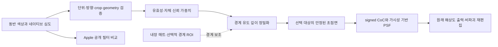

# 심도 품질 개선 개발 기획

2026-11-25 KST. 근거는 [51 조사](51-DEPTH-QUALITY-RESEARCH.ko.md)와 [직접 조회 기록](research/2026-11-25-depth-quality-sources.json). [49 방향](49-NATIVE-DEPTH-LENS-PRIORITY.ko.md)·[50 로컬 N1 구현](50-NATIVE-DEPTH-FIRST-IMPLEMENTATION.ko.md)을 이어가는 실행 계획이다. **이 문서의 후속 알고리즘/모듈은 아직 구현·기기 인수되지 않았다.**

## 1. 목표와 이번 기획에서 정한 선택

목표는 iPhone15Pro에서 네이티브 사진 심도를 이용해 원통·병·사람·얇은 구조·바닥 등 다양한 장면에 자연스럽고 안정된 자체 렌즈 흐림을 만드는 것이다. 흐림 강도를 키우는 것보다 **물체 가장자리, 연속적인 거리 변화, 앞뒤 가림, 초점 유지**를 먼저 개선한다.

- 기본 입력: 동반 색상과 네이티브 depth/disparity. 품질·정합이 불확실하면 보수적으로 처리한다. AI 상대 깊이는 기존 명시적 경로로 유지한다.
- 첫 경계 정밀화 후보: **MPSImageGuidedFilter + 유효 깊이/신뢰 anchor**. bilateral solver는 오프라인 참조와 어려운 사례의 대안이다.
- 자체 렌즈 합성: 기존 linear/premultiplied signed-CoC 구조를 유지하고 가시성/coverage·층 배분을 개선한다. Dr.Bokeh를 알고리즘 참조로 쓴다.
- 비교 기준: 같은 RGB/depth에 적용한 Apple 공개 깊이 필터, 현재/N1 자체 렌더러, 새 후보를 함께 비교한다. Apple 기본 카메라 완성본은 별도 제품 참고다.
- 신규 neural 보정: 기본 파이프라인의 필수 단계로 만들지 않는다. 이후 실제 개선이 확인되는 경계 ROI만 실험실 후보로 검토한다.
- 출시 동작: 사용자는 기존처럼 터치·길게 눌러 잠금·f값·렌즈 프로필로 조절한다. 내부 알고리즘별 슬라이더를 기본 화면에 늘리지 않는다.

기존 기능/설정·원본 보존·SDR·공유/원본 위치 정책을 유지한다. 기존 심도 개선은 기본 기능으로 발전시키고, 새 외부 AI만 선택 실험실이라는 사용자 결정을 따른다. 15Pro/27.2는 사용자 제공 목표 기기이며 실제 연결/검증 완료를 뜻하지 않는다.

## 2. 목표 처리 구조와 데이터 계약

| 제안 모듈 | 책임·계약 | 연결할 기존 코드 |
|---|---|---|
| `NativePhotoDepthReader` | typed depth/disparity·원래 calibration/필터 여부·방향 적용 상태·촬영 geometry 추출. 첨부 없음과 무효 첨부 구분 | NaturalDepthEngine.measured, CameraService |
| `DepthGeometry` | 원래 색상/깊이·방향 적용 색상/깊이·표시/터치 좌표의 명시적 변환. 원래 intrinsics 참조 좌표 보존 | CameraOrientation/preview touch 변환, NativeDepthMetadata |
| `DepthReliabilityMap` | 결측·유효·필터링된 입력·국소 재구성·수동 교정의 역할/가중치 구분 | SoftwareDepthField, diagnostic 보기 |
| `DepthGuidedUpsampler` | 신뢰 native 영역을 고정하고 unknown 경계만 RGB/깊이 유도로 정밀화. 전역 거친 지도와 고해상도 ROI 분리 | MPS, DepthMatteRefiner, high-resolution tile |
| `DepthFocusEstimator/State` | 선택 ID/영역·깊이 군집에서 초점값 계산, 시간 안정화·가림/세대 폐기 | focusValue, SubjectTrackingSnapshot, VideoDepthStabilizer |
| 가시성 처리 | signed CoC·앞뒤 층 가시성·premultiplied 색/coverage·적응 sampling | NaturalDepthEngine, DepthLensFilter/PSF, BackgroundExtension |
| ROI 저장 계층 | alpha/보정 patch와 base depth·renderer 버전·hash·좌표·복원 관리 | CaptureResultProcessor, DepthPhotoEditor/Corrections |

이름은 구현을 나누기 위한 제안이며 파일이 이미 존재한다는 뜻은 아니다. 기존 공통 코드를 복제하기보다 순수 계산 정책과 GPU/AVFoundation adapter를 분리한다.

### 단위·좌표·입력 색상

1. depth/disparity는 Apple API로 변환한다. HEIC의8bit 보조 코드에 임의로 미터 단위를 붙이지 않는다. 절대 accuracy가 확인된 경우에만 물리 거리 기반 계산을 쓴다.
2. 방향·미러·zoom/crop 변환은 한 계약에서 한 번 적용한다. 정렬된 동반 색상/깊이에 임의 rectification을 추가하지 않는다. 이종 센서/ARKit 3D 재투영은 별도 경로다.
3. intrinsics는 자신의 reference dimensions/원래 방향과 함께 취급한다. N1의 원래 첨부 요약을 현재 preview 좌표의 보정 행렬처럼 바로 사용하지 않는다.
4. 깊이/alpha는 수치 데이터다. display gamma를 적용하지 않는다. 경계 guidance는 LUT·그레인·모니터 효과를 넣기 전 동반 색상에서 얻는다.
5. 광학적으로 이미 흐린 입력 영역이나 가려진 배경을 재초점으로 복구한다고 약속하지 않는다. 가상 렌즈의 초점거리·센서 크기·crop/FOV convention을 명시하고, 실제 촬영 렌즈/원근이 바뀐다고 표현하지 않는다.

### 신뢰도와 경계

- AVDepthData의 전체 quality를 픽셀별 확률로 복사하지 않는다. ARKit confidence가 있으면 해당 경로에서만 사용하고, 일반 사진의 구조적 가중치와 구별한다.
- 필터링된 유효 깊이는 ‘입력으로 전달된 유효 값’이다. 모두 직접 관측치라고 단정하지 않는다. 결측 영역의 국소 보완은 native 측정으로 재명명하지 않는다.
- 연속 표면 내부의 작은 hole과 물체 앞뒤 경계를 가로지르는 hole을 구분한다. 후자는 반대편 물체의 값으로 무조건 채우지 않는다. 복원 근거가 없으면 효과를 부드럽게 약화하거나 원본을 유지한다.
- RGB의 글자·표면 무늬·그림자는 깊이 경계와 다를 수 있다. 깊이 불연속/구조 일관성·매트와 함께 판단해 texture copying을 억제한다.
- 불투명 기하 경계, 머리카락/털의 부분 coverage, 유리/반사의 혼합 관측을 분리한다. 유리에서는 보수적 처리가 자동으로 강한 보케를 만드는 것보다 우선이다.

## 3. 단계별 실행 계획

| 순서·기존 계획 대응 | 개발 내용 | 구체적인 산출물과 통과 조건 |
|---|---|---|
| 1 — N0 기준선/SDK | SDK27.2 실제 빌드, native RGB/depth 보관·공개 Apple 필터 비교 adapter, 구간 trace | iOS18 최소 정책 보존, native·Simulator 빌드/기존 회귀. 같은 입력/hash의 비교 묶음, 지원 없는 필터 조건은 명시. 단계별 시간·메모리·열/system pressure 기록 |
| 2 — N2a geometry·신뢰 | NativePhotoDepthReader 분리, DepthGeometry/자체 신뢰 지도 | 8개 EXIF 방향·전면 미러·crop/zoom·가로/세로·입력 크기 차이 fixture. 첨부 없음/무효/상대/절대/필터/낮은 quality의 상태를 구분. 보정 불명확 시 잘못된 거리 합성 거부 |
| 3 — N2b 경계 정밀화 | MPS regression/reconstruction·신뢰 anchor·unknown 경계/작은 hole 보완 | 원통/병 테두리·동일색 앞뒤 물체·표면 글자/그림자·깊이 step 검증. native 안정 영역의 변화와 경계 누출을 따로 측정. 단순 보간/기존 렌더 대비 개선이 없는 후보는 기본 경로로 승격하지 않음 |
| 4 — N2c 초점 안정화 | 선택 물체 내부 깊이 군집·대표값, identity/세대/단위별 focus state | 얇은 물체 주변 배경 혼입 억제, 정지 대상의 초점/CoC 변동 감소. 새 터치는 즉시 반영하고 AF/AE 잠금을 유지. 가림·ID 전환·회전·렌즈 전환 시 이전 초점 이력 오사용 거부 |
| 5 — N3a 렌즈 합성 | 층간 가시성·근경 확산·배경 occlusion·CoC 적응 층/샘플 | 앞 물체의 색이 뒤에 번지거나 뒤 보케가 앞 물체를 덮는 오류를 독립 reference로 검사. 상수 색·점광원·에너지/coverage·조리개 단조성·바닥 연속 흐림. 동일 입력의 반복 결과 안정 |
| 6 — N3b 고해상도/저장 | 전역 지도+경계 ROI, halo 타일·고해상도 alpha patch·recipe 복원 | 24/48MP 및 지원 입력에서 원래 해상도 출력, tile seam·재편집 경계 보존·원본 hash·취소/저장공간 부족·메모리 예산 검사. 512px 저장으로 다시 축소되는 경로 제거 |
| 7 — N4 대상/UX 통합·사진 인수 | 기존 선택/추적/광학 AF와 합성 초점 역할 연결, 내부 진단·기본 간편 UI | 사진 정밀 선택을 시간 추적으로 표시하지 않음. 촬영 시점 선택/좌표와 저장 native 깊이의 대응 확인. 실제100장/3명 blind·기기 trace 기준으로 전체 회귀와 사진 인수 |
| 8 — N5 영상 | 검증한 geometry/신뢰/CoC 재사용, native 동기 stream 또는 명시적 기존 대체, 시간 안정화 | 지원 포맷에서 AVCaptureDepthDataOutput+동기화 검증. photo depth가 영상에 그대로 들어온다고 가정하지 않음. 기존 영상/오디오 유지·10종 실제 영상·장시간 열/지연 검사 후 기본 확대 |

50의 N1은 이미 로컬에 첫 수정이 있지만 SDK·기기 인수는 남아 있다. 위 순서는 N1을 다시 완료했다고 세는 계획이 아니다. **다음 구현 단위는 동일 입력 기준선과 NativePhotoDepthReader/DepthGeometry**로 정한다. 두 작업의 검증 입력을 만든 뒤 MPS 경계 정밀화에 들어간다. 이번 기획 때문에 추가 모델 선택이나 사용자 확인을 기다릴 필요는 없다.

### 초점·추적의 세부 동작

터치 주변 모든 픽셀의 단일 중앙값 대신, 터치한 표면과 연결된 깊이 군집/선택 영역에서 이상치를 배제한 대표 inverse depth를 구한다. 물체가 작다고 더 큰 사각 영역으로 넓혀 배경을 더 섞지 않는다. 근거가 약하면 초점값을 확정한 것처럼 표시하지 않는다.

시간 안정화는 선택 ID·렌즈/geometry 세대·단위가 같고 관측이 일관될 때만 적용한다. 수동 터치/초점 잠금은 자동 완만화보다 우선한다. 불확실 상태에서 다른 물체로 임의 전환하지 않는다. 새 물체를 탭하면 이전 선택 매트와 초점 이력을 폐기한다. 상대 깊이의 scale 변화는 안정적인 대응점으로만 보정하고 물리 거리로 승격하지 않는다.

사진 저장에는 촬영 시점의 선택 정보가 필요하다. 비동기 추적의 ‘가장 최근’ 좌표를 나중에 도착한 다른 순간의 심도와 무조건 조합하지 않는다. 시간/geometry 대응을 입증하지 못하면 선택 신뢰 부족으로 처리한다. optical AF 성공, 추적 상자 안정, 디지털 초점면 정확도는 각각 평가한다.

### 렌즈 합성의 세부 동작

절대 깊이에서는 기존 thin-lens signed CoC를 출발점으로 쓴다. 가상 렌즈 f(m), 초점 거리 s(m), 물체 거리 z(m), f-number N, 출력 긴 변 L(px), 가상 센서 긴 변 S(m)일 때 반경은 다음과 같다.

`r = f²·s / (2·N·(s−f)) · (1/s−1/z) · L/S`

현재 부호 convention의 음수는 가까운 전경, 양수는 먼 배경이다. 상대 깊이는 별도 가상 강도 계약을 유지한다. 사진의 다른 물체가 바뀌었다고 동일 절대 깊이의 CoC가 달라져서는 안 된다. 반경 제한·불확실 영역·잘린 관측은 별도로 처리한다.

근경 coverage는 선명한 배경 위로 확산되고 원경은 앞 물체에 가려져야 한다. 깊이/CoC의 유사성만으로 앞뒤 색을 섞는 평균 필터는 피한다. Dr.Bokeh의 가시성 처리를 참조하되 기존 선형 premultiplied pipeline과 Metal 타일 제약에 맞게 재설계한다. 큰 반경의 피라미드는 유지하고 점광원 분열/너무 둔한 하이라이트를 함께 검사한다.

샘플 예산은 megapixel 한 개의 기준으로만 반으로 줄이지 않는다. CoC 크기·깊이 불연속·보케 하이라이트·가림 ROI에 우선 배분하고 최종 사진 품질 모드와 preview 예산을 분리한다. 무조건 모든 픽셀에 최대 층/샘플을 적용하지 않는다.

### 고해상도 재편집

현재 매트 저장은 alpha+전경RGB+배경RGB의7 Float,28bytes/px다. 이를 전체48MP로 늘리면 약1.344GB이므로 상한만 높이는 접근은 피한다. 전역 낮은 해상도 깊이와 필요한 경계 patch를 나누고, alpha의 선형 정밀도·필요한 색 보정·좌표/hash를 제한 저장한다. 예를 들어 UInt16 alpha는48MP에서96MB이며 **이는 sidecar 데이터 산술량이지 앱 peak memory 측정값이 아니다.** 전체 프레임을 항상 저장하겠다는 결정도 아니다.

지원되지 않는 새 patch 정보를 기존 decoder가 조용히 버리지 않도록 recipe/renderer 버전을 명시한다. 버전5 등이 필요하면 목록 표시·loadSession·editor·내보내기·검증 도구를 함께 변경한다. 기존2/3/4와 선택적인 N1 nativeDepth는 호환 복원하고 원래 JPEG/지도는 보존한다. 새 엔진으로 만든 결과는 새 결과로 저장하며, 구형 결과 재현과 명시적인 새 엔진 재처리를 구분한다.

## 4. 품질·성능 평가 계획

### 동일 입력 비교

같은 원본 색상/깊이/hash/방향·출력 크기로 다음을 비교한다. blur 제어의 의미가 서로 다르면 유효 CoC/관찰되는 흐림 반경도 함께 기록하고 숫자 f값만 같다는 이유로 동일 조건이라 하지 않는다.

1. 무효과 원본, 현재 N1 자체 렌더러.
2. 지원 조건에서 Apple 공개 depth blur filter.
3. 새 경계/초점 처리만 적용, 새 가시성 PSF만 적용, 둘을 적용한 결과.
4. 기존 AI 옵션 Off/각각/모두의 차이. AI 성공과 최종 합성 기여를 구분해 표시한다.

Apple Camera 완성본 비교는 촬영 시각·렌즈·거리·광량·노출 차이가 있는 별도 항목이다. 전달받은 비교 HEIC만으로 위 동일 입력 A/B를 수행했다고 기록하지 않는다.

### 자동 검증과 실사 지표

| 분야 | 자동 fixture/측정 | 실사 판정 |
|---|---|---|
| 정합/깊이 | 알려진 평면·step·경사면·hole·8방향/미러 변환, anchor 변화·누출 | 동일색 물체·원통·글자/그림자에서 경계 유지. GT 없는 자료에 절대 거리 RMSE를 만들지 않음 |
| alpha/윤곽 | 알려진 alpha의 경계 오차·가는 구조·coverage·색 오염 | 모발·털·식물·병 뚜껑/테두리·유리의 실패 형태를 분리 |
| 광학 합성 | 독립 고샘플 aperture/가시성 CPU reference, flat DC·점광원·앞뒤 가림·f값 변화·타일 일치 | halo·전경 번짐·배경 색 오염·바닥 거리별 흐림·하이라이트 형태 |
| 초점/시간 | 같은 대상의 inverse-depth/CoC 분산, ID/세대/가림 reset, 오래된 입력 거부 | 대상 이동·잠금·가림·새 탭에서 잘못된 초점 이동·깜빡임 |
| 보관/출력 | 원본 hash, 구형/새 recipe round-trip, 취소·중단·저장 부족 | 24/48MP 확대와 재열기에서 경계 품질 유지 |
| 기기 자원 | CPU/GPU 구간·p50/p95 지연·frame drop·RSS·system pressure/thermal state | 동일 조건10분 preview와 촬영 후 처리 별도 기록. 열 감소는 실제 trace 비교로 판정 |

단순 샘플 코드를 정답으로 복사한 테스트 대신 기하/광학의 독립 reference와 불변 조건을 쓴다. synthetic 정답과 사람의 경계 라벨, 주관 화질 점수는 따로 보고한다. 기존 정식100장·영상10종·3명 blind gate는 유지한다.

사진100장 구성 제안은 불투명 물체20·인물20·가는 구조12·전경 가림12·바닥/중원거리12·반사/투명8·저조도8·움직임/촬영 안정성8이다. 같은 장면의 f값/옵션 변형을 새로운 독립 장면으로 중복 세지 않는다. 동의·자료 권리와 원본/recipe를 기존 manifest 계약으로 관리한다.

preview 목표는 N1의 nominal 최대30fps 예산 안에서 기기 p95 지연을 측정하는 것이다. 최대 fps 설정이 실제30fps 보장을 뜻하지 않는다. 사진 처리 시간·전력/메모리 허용치는 N0 실측 뒤 정하고, 사전 근거 없이 개선율이나 온도 수치를 정해 통과했다고 기록하지 않는다. 출력 품질을 위해 느린 고품질 처리가 필요하면 preview와 분리한다.

## 5. 승격·중단 기준과 남은 범위

- MPS 후보가 무늬/그림자를 가짜 깊이로 만들거나 인물/비인물 회귀를 일으키면 기본 경로 승격을 보류한다. 해당 영역의 기존 native 값/원본 보호로 돌아가고 solver/ROI 대안과 비교한다.
- 새 PSF는 더 강한 흐림이 아니라 동일 입력의 경계·가림 개선으로 판정한다. 앱 전체 native/UI 회귀와 실사 gate 없이 ‘DSLR급/업계 최고’로 표시하지 않는다.
- 영상은 사진의 좋은 단일 프레임만으로 승격하지 않는다. 시간 일관성·녹화 지원 포맷·오디오·장시간 열 검증을 별도로 요구한다.
- 외부 소스는 연구 캐시로 읽은 것과 앱 이식·가중치 채택을 구분한다. 실제 이식이 생기면 출처/revision·수정 범위·조건·검증 결과를 일지/provenance에 남긴다.

이번 작업의 완료물은 조사51·본 실행 계획52·근거 JSON·백로그/일지 갱신이다. 앱/모델·테스트 코드는 추가 변경하지 않았고 새 빌드/벤치마크/커밋/푸시도 수행하지 않았다. N1의 기존 로컬 변경과 이전 테스트 기록은 보존한다.
